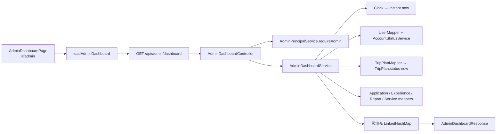

# 设计：add-admin-dashboard

- **Change：** `add-admin-dashboard`（`admin-dashboard` ADDED，REQ-023 / S25）
- **基线：** `main@a2ee518` ｜ **日期：** 2026-11-17 ｜ **Owner：** Jacky（SA，当前开发者）
- **输入：** `specs/admin-dashboard/spec.md`（5 Requirement / 13 Scenario）、`proposal.md`、`g1-decision.md`（C1–C6）、`docs/reviews/20261117-add-admin-dashboard-spec-review.md`（S1-06 键名裁决）、as-is 代码
- **上游依赖：** `add-admin-console`（`p3-pass`，未归档）；本 change 复用其 `AdminPrincipalService`、`AdminGuard`、`AdminLayout` 与错误码，不重复定义

## 1. 设计目标

用一个只读端点 + 一个页面回答「平台现在有多少人、多少行程、多少待处理事项」：

- **后端是唯一计数权威。** 六个计数、有效账号状态、行程五态、7 / 30 天窗口都在一次请求内算完；前端不重算、不补零、不推断状态。
- **一次请求一个时刻。** 全部分组共用同一个 `Clock` 读到的 `Instant`，总数与分桶来自同一批内存行，杜绝「两次查询之间的并发漂移」。
- **只读，不物化。** 不加表、不加迁移、不加索引、不加缓存、不加定时任务；每次请求即时 `SELECT`。
- **图表只表达快照分布。** 卡片上的条形 / 环形只画本次返回的分桶占比；不做趋势、时间序列或同比（提案 Out of scope）。

**分工铁律：** 账号状态只由 `AccountStatusService.effectiveStatus` 判定；行程状态只由 `TripPlan.status(now)` 推导；窗口只由后端按 `Asia/Shanghai` 自然日计算；前端只做格式化与渲染。

## 2. 组件与职责



| 单元 | 落点 | 职责 |
|---|---|---|
| `AdminDashboardController` | `backend/src/main/java/routeme/controller/AdminDashboardController.java` | `GET /api/admin/dashboard`；`Authorization` 头 → `requireAdmin`；返回 200 |
| `AdminDashboardService` | `backend/src/main/java/routeme/service/AdminDashboardService.java` | 接口：`AdminDashboardResponse overview()` |
| `AdminDashboardServiceImpl` | `backend/src/main/java/routeme/service/impl/AdminDashboardServiceImpl.java` | 单时刻、六表取数、分桶、零填充、窗口 |
| `AdminDashboardResponse` + 6 个计数 record | `backend/src/main/java/routeme/response/` | 契约模型；`@JsonInclude(NON_NULL)` 不使用（计数字段必须出现） |
| `AdminDashboardPage` | `frontend/src/admin/dashboard/AdminDashboardPage.tsx` | 加载 / 就绪 / 失败三态、手动刷新、六卡布局 |
| `AdminMetricCard` | `frontend/src/admin/dashboard/AdminMetricCard.tsx` | 卡片壳：标题、总数、图表插槽、可选跳转、可选脚注 |
| `dashboardFormat.ts` | `frontend/src/admin/dashboard/dashboardFormat.ts` | 纯函数：百分比、堆叠段、环形段、窗口文案、更新时间文案 |
| `loadAdminDashboard` | `frontend/src/api.ts` | `GET /admin/dashboard` + Bearer |
| `AdminDashboard*` 类型 | `frontend/src/types.ts` | 与契约一一对应 |
| 路由 | `frontend/src/route.ts`、`App.tsx` | `#/admin` → `{ name: 'adminDashboard' }`；`AdminGuard` 内挂载 |
| 导航 | `frontend/src/admin/AdminLayout.tsx`、`shell/AppShell.tsx` | `AdminTab` 增加 `dashboard` 且置于首位；两处「管理后台」入口改指 `#/admin` |
| 文案 | `frontend/src/i18n/adminMessages.ts` | 概览页全部中文文案与状态名 |
| 样式 | `frontend/src/styles.css` | `admin-dashboard-*` 布局与图表；颜色复用既有 CSS 变量 |
| 契约 | `RouteME/openapi.yaml` | 0.17.0 → **0.18.0**；新路径 + 7 个 schema |
| 契约测试 | `backend/src/test/java/routeme/controller/OpenApiTest.java` | 版本、路径、schema 必需键 |

## 3. 接口契约

`GET /api/admin/dashboard`

| 项 | 值 |
|---|---|
| 认证 | `Authorization: Bearer <token>`（`BearerToken` 参数，必填） |
| 200 | `AdminDashboard` |
| 401 | `Unauthorized`（无 / 无效会话） |
| 403 | `AdminRequired`（`role≠ADMIN`）、`AccountRestricted`（管理员 `SUSPENDED` / `BANNED`，沿用既有错误码） |
| 缓存 | 无；200 响应头 `Cache-Control: no-store`（与只读即时计算一致） |
| 参数 | 无查询参数、无请求体 |

**响应示例**

```json
{
  "users": {
    "total": 42,
    "by_role": { "USER": 41, "ADMIN": 1 },
    "by_status": { "ACTIVE": 39, "SUSPENDED": 2, "BANNED": 1 },
    "new_last_7_days": 3,
    "new_last_30_days": 11
  },
  "trips": {
    "total": 18,
    "by_status": { "recruiting": 5, "full": 2, "ongoing": 1, "completed": 9, "cancelled": 1 },
    "new_last_7_days": 2,
    "new_last_30_days": 6
  },
  "applications": {
    "total": 33,
    "by_status": { "pending": 4, "accepted": 15, "rejected": 8, "cancelled": 4, "left": 2 }
  },
  "experiences": {
    "total": 12,
    "new_last_7_days": 1,
    "new_last_30_days": 5
  },
  "reports": {
    "total": 7,
    "by_status": { "PENDING": 3, "PROCESSING": 1, "RESOLVED": 2, "REJECTED": 1 }
  },
  "service_sessions": {
    "total": 6,
    "by_status": { "WAITING": 2, "HANDLING": 1, "CLOSED": 3 }
  },
  "generated_at": "2026-11-17T09:00:00Z"
}
```

### 3.1 键名与大小写（G1 C2，S1-06）

- 组名与字段名一律 `snake_case`（`@rule:api-contract`）；Delta Spec 已在 P3 入口按同一规则修正命名，语义未变。
- `by_*` 的**键**沿用两侧既有 wire 词表，不新造第三套：

| 分布 | 固定键（顺序即零填充顺序） |
|---|---|
| `users.by_role` | `USER`、`ADMIN` |
| `users.by_status` | `ACTIVE`、`SUSPENDED`、`BANNED` |
| `trips.by_status` | `recruiting`、`full`、`ongoing`、`completed`、`cancelled` |
| `applications.by_status` | `pending`、`accepted`、`rejected`、`cancelled`、`left` |
| `reports.by_status` | `PENDING`、`PROCESSING`、`RESOLVED`、`REJECTED` |
| `service_sessions.by_status` | `WAITING`、`HANDLING`、`CLOSED` |

- `generated_at` 为 RFC3339 UTC（`_at` 后缀），必填、非空。
- 计数字段一律 `integer`；不使用 `nullable`；0 就是 `0`。
- 响应**不含**昵称、邮箱、头像、ID、标题或任何可识别到个人的字段（`@rule:pii-scrubbing`）。

### 3.2 `openapi.yaml` schema 结构

新增 schema，全部 `additionalProperties: false`，并用 `required` 列出**每一个**状态键（OpenAPI 3.0.3 无法用 `enum` 约束对象键名，因此以「required 全集 + 禁止额外键」锁定键集合；状态取值的唯一事实源仍是既有 `AccountStatus` / `ReportStatus` / `ServiceSessionStatus` 等 enum schema）：

| Schema | required 字段 |
|---|---|
| `AdminDashboard` | `users`、`trips`、`applications`、`experiences`、`reports`、`service_sessions`、`generated_at` |
| `AdminDashboardUsers` | `total`、`by_role`、`by_status`、`new_last_7_days`、`new_last_30_days` |
| `AdminDashboardTrips` | `total`、`by_status`、`new_last_7_days`、`new_last_30_days` |
| `AdminDashboardApplications` | `total`、`by_status` |
| `AdminDashboardExperiences` | `total`、`new_last_7_days`、`new_last_30_days` |
| `AdminDashboardReports` | `total`、`by_status` |
| `AdminDashboardServiceSessions` | `total`、`by_status` |

`by_*` 为内联对象，`required` 为 §3.1 对应行的全部键，`additionalProperties: false`，每个键 `type: integer`、`minimum: 0`、`readOnly: true`。

**C2 合规说明：** OpenAPI 3.0.3 不能对对象键名使用 `enum`。本设计以「`required` 全集 + `additionalProperties: false` + `OpenApiTest` 字面断言键集合」达到同等效果；状态取值本身仍由既有 `AccountStatus` / `ReportStatus` / `ServiceSessionStatus` / `TripStatus` / `ApplicationStatus` enum schema 定义，不新造词表。

**契约号段：** 0.17.0 → **0.18.0**；P4 定稿前复核是否已被在途 change 预约（C2）。

## 4. 后端行为

### 4.1 单时刻与单次遍历（C1）

```java
Instant now = clock.instant();                       // 全请求唯一时刻
LocalDate today = LocalDate.ofInstant(now, TripTimeZoneConstant.ZONE);
```

1. 六张表各一次 `selectList(null)`，不做逐行 `getById` / `selectCount`（禁止 N+1）。
2. 总数与分桶来自**同一份内存列表**；先分桶，再以列表大小作为 `total`。
3. 不调用任何会写库的读取服务：**特别是不调用 `TripPlanService.findAllTrips()`**，因为它带 `@Transactional` 且先执行 `materializeExpired()`（写库）；概览端点必须只读。
4. 不开启事务：六次查询之间允许出现极短并发窗口，但每个分组内部的总数与分桶始终自洽（同一次列表）；跨组不承诺同一数据库快照，Delta 也未要求。

| 组 | 数据源 | 分桶键 |
|---|---|---|
| `users` | `UserMapper.selectList(null)` → `UserEntity` | `AccountRoleEnum.of(role).code()`；`AccountStatusService.effectiveStatus(entity).code()` |
| `trips` | `TripPlanMapper.selectList(null)` → `entity.toTripPlan()` | `trip.status(now).wireValue()` |
| `applications` | `TripApplicationMapper.selectList(null)` | `ApplicationStatusEnum.valueOf(status).wireValue()` |
| `experiences` | `TripExperienceMapper.selectList(null)` | 无状态；只算总数与新增 |
| `reports` | `ReportMapper.selectList(null)` | `ReportStatusEnum.of(status).code()` |
| `service_sessions` | `CustomerServiceSessionMapper.selectList(null)` | `ServiceSessionStatusEnum.of(status).code()` |

### 4.2 计数与零填充

- `LinkedHashMap<String, Integer>` 先按 §3.1 顺序放入全部键 = 0，再 `merge(key, 1, Integer::sum)`；因此**空库返回全 0 且不省略键**。
- `total` = 该组列表大小；分桶键取自闭合枚举，持久化值不在枚举内视为数据缺陷，请求失败而不是静默丢弃（正常写入路径由服务层保证取值合法）。
- 用户组同时产出角色分桶与有效状态分桶；两者都应等于 `total`（P4 断言）。
- 行程、申请、举报、会话的 `total` 等于各自 `by_status` 之和（P4 断言）。

### 4.3 有效账号状态（复用既有口径）

- 直接调用 `AccountStatusService.effectiveStatus(UserEntity)`：`BANNED` 且 `ban_expires_at` 已过 → 计入 `ACTIVE`；该方法是只读的，不写回惰性解封。
- 用户总数包含 `ADMIN`（角色分桶显式含 `ADMIN`）。
- 不复制 `isBanExpired` 逻辑，避免治理页与概览口径漂移。

### 4.4 行程五态（复用既有推导）

- `TripPlan.status(now)` 的优先级：`cancelled` > `completed` > `ongoing` > `full` > `recruiting`。
- 已取消行程计入 `total` 与 `cancelled`，不再落入 `recruiting`；已结束（`completed_at` 非空或已过结束日次日 00:00）优先于旅行中。
- 不新增持久化状态列，不写第二套判定。
- 现有 `TripPlan.status(Instant)` 注释仍写「四态推导」；P4 顺手把注释改为「五态（含已取消）」，**不改逻辑**（C6 的措辞统一在 P5 归档前复核）。

### 4.5 新增计数窗口

- 时区固定 `TripTimeZoneConstant.ZONE`（`Asia/Shanghai`）。
- `today = LocalDate.ofInstant(now, ZONE)`；
  - 7 天窗口 = `[today-6 00:00, now]`；
  - 30 天窗口 = `[today-29 00:00, now]`。
- 以记录 `created_at` 判定，**不看** `updated_at` / `decided_at` / `processing_at` / `closed_at`。
- 解析失败或 `created_at` 缺失的记录不计入新增（不抛错，避免单条脏数据打挂概览）；总数仍包含它。
- 覆盖组：`users`、`trips`、`experiences`；`applications`、`reports`、`service_sessions` 不产出新增字段。

### 4.6 查询条数与索引现状（C4）

| 表 | 每次请求查询 | 现有索引 | 结论 |
|---|---|---|---|
| `app_users` | 1 次全表 | 无 `created_at` 索引 | 全扫；演示规模可接受 |
| `trip_plans` | 1 次全表 | 无概览用索引 | 全扫；需整行才能复用 `status(now)` |
| `trip_applications` | 1 次全表 | 无 | 全扫 |
| `trip_experiences` | 1 次全表 | 无 | 全扫 |
| `reports` | 1 次全表 | 有 `(status, created_at)` | 走全扫（本轮不按状态过滤） |
| `customer_service_sessions` | 1 次全表 | 有 `(status, created_at)` | 走全扫 |

- 合计 **6 条 SELECT / 请求**，无 N+1。
- 不新增索引、不新增迁移；数据量增长后的优化（覆盖索引或计数表）另开需求（C4 / R-3）。

## 5. 前端行为

### 5.1 路由与导航（C5）

| 项 | 变更 |
|---|---|
| `Route` | 新增 `{ name: 'adminDashboard' }` |
| `parseRoute` | `/admin` → `adminDashboard`；其余 `/admin/**` 保持既有匹配顺序 |
| `routeToHash` | `adminDashboard` → `#/admin` |
| `AdminTab` | `'dashboard' \| 'users' \| 'reports' \| 'service'` |
| `TABS` | 顺序：概览 → 用户管理 → 举报管理 → 客户服务；概览 `href: '#/admin'` |
| `AppShell` | 侧栏与移动端 Tab 的「管理后台」入口 `href` 由 `#/admin/users` 改为 `#/admin` |
| `App.tsx` | `route.name === 'adminDashboard'` → `<AdminGuard>{(token) => <AdminDashboardPage token={token} />}</AdminGuard>` |

- `AdminGuard` 仍是前端兜底：非 `ADMIN` 或无 token 时只渲染无权限提示，**不发起任何 `/api/admin/**` 请求**；安全边界仍在服务端 `requireAdmin`。

### 5.2 页面状态机

```text
loading  首次请求 / 手动刷新中 → Skeleton（不显示旧数字的半新半旧状态）
ready    200 → 六张卡 + 最近更新时间
error    4xx/5xx/网络失败 → Alert + 「重试」，保留上次成功数据的说明不展示
```

- `useEffect` 只依赖 `reloadKey` 与 `token`；**不设 `setInterval`、不订阅推送**，停留 60 秒不发请求。
- 「刷新」按钮 = `reloadKey + 1`；成功后更新数字与 `generated_at`。
- 失败态重试 = 同一请求再发一次，不改变筛选（本页无筛选）。
- 请求竞态：复用页面内递增 token 或「仅最后一次响应生效」的写法，避免双击刷新时旧响应覆盖新响应。
- 计数 0 渲染为 `0`，不以空白或 `—` 替代。
- 最近更新时间用既有 `adminFormat.formatDateTime`，前缀文案「最近更新」。

### 5.3 六张卡片与图表

视觉方向沿用已确认的静态预览：**堆叠分布条 + 7/30 天进度 + 环形占比**，全部是「本次快照的分布」，不含任何时间轴。

| 卡片 | 主数字 | 图 | 可点击 |
|---|---|---|---|
| 用户 | `users.total` | 两条堆叠条：角色（USER/ADMIN）、有效状态（ACTIVE/SUSPENDED/BANNED）；脚注 7 天 / 30 天新增 | 是 → `#/admin/users` |
| 行程 | `trips.total` | 五段堆叠条（招募中 / 已满员 / 旅行中 / 已结束 / 已取消）；脚注 7 / 30 天新增 | 否 |
| 同行申请 | `applications.total` | 五段堆叠条（待处理 / 已接受 / 已拒绝 / 已取消 / 已退出） | 否 |
| 旅行体验 | `experiences.total` | 「7 / 30 天」两条水平进度：7 天新增 / 30 天新增 | 否 |
| 举报 | `reports.total` | 四段环形；圆心显示 `PENDING` 数，副标「待处理」 | 是 → `#/admin/reports` |
| 客服会话 | `service_sessions.total` | 三段环形；圆心显示 `WAITING` 数，副标「等待接入」 | 是 → `#/admin/service` |

- **实现方式：** 堆叠条用 flex + 宽度百分比；环形用内联 `<svg>` + `stroke-dasharray` / `stroke-dashoffset`。**不新增图表依赖**（`package.json` 现有依赖不含图表库）。
- **可点击边界：** 三张可跳转卡整卡为 `<a>`（键盘可达、有 `aria-label`）；行程 / 申请 / 体验卡为 `<section>`，不渲染 `href`、不加 `tabIndex`、不绑定点击。
- **配色：** 只复用现有 CSS 变量与 antd 主题色；新增的 `--admin-chart-*` 变量集中在 `styles.css` 的 `:root` / 暗色块，不在组件内写色值。
- **零总数：** 条为空轨道、环形为完整灰色底环、圆心 `0`；图例仍列出全部键与 `0`。
- **无数据图例不隐藏：** 图例逐项显示「名称 + 数字 + 占比」，占比为 0 时显示 `0%`（`total=0` 时全部 `0%`，不出现 `NaN`）。

### 5.4 可访问性与响应式

- 每张图 `role="img"` + `aria-label`（如「用户角色分布：普通用户 41，管理员 1」）；图例文字本身可读，不依赖颜色。
- 卡片标题用 `<h2>`；页面标题 `<h1>` 由 `AdminLayout` 提供。
- 1440 / 768 / 390：桌面 3 列 × 2 行；平板 2 列；390 单列纵向堆叠，图表最小高度保留，不出现横向滚动。
- 只支持浅 / 深色既有主题，不新增主题。

### 5.5 文案与探针

- 全部中文文案进 `adminMessages`（`dashboardTitle`、`dashboardSubtitle`、`dashboardUpdatedAt`、`dashboardRefresh`、`dashboardLoadFailed`、六组标题、状态短名、`dashboardNew7`、`dashboardNew30`、`dashboardPending`、`dashboardWaiting` 等）。
- `data-testid`：`dashboard-page`、`dashboard-card-users`、`dashboard-card-trips`、`dashboard-card-applications`、`dashboard-card-experiences`、`dashboard-card-reports`、`dashboard-card-service`、`dashboard-refresh`、`dashboard-error`、`dashboard-retry`、`dashboard-updated-at`、`dashboard-chart-users-role`、`dashboard-chart-users-status`。

### 5.6 纯函数（P4 单测对象）

`dashboardFormat.ts`：

| 函数 | 语义 |
|---|---|
| `percentOf(part, total)` | `total=0` → `0`（不 `NaN`）；否则四舍五入到整数 |
| `stackSegments(counts, order, labels)` | 输入分桶与固定键序 → `[{ key, label, value, percent }]`，过滤 0 宽段但保留图例项 |
| `donutSegments(counts, order)` | 生成 `stroke-dasharray` 所需的累计偏移 |
| `windowRatio(part, windowDays)` | 7 / 30 天进度比例，封顶 100%，`part=0` → 0 |
| `formatCount(n)` | 千分位；0 → `0` |

## 6. 契约落地（openapi.yaml 0.18.0）

1. `info.version` → `0.18.0`。
2. 新增路径 `/admin/dashboard`（`get`，`operationId: getAdminDashboard`），参数 `BearerToken`，响应 200 / 401 / 403；200 声明响应头 `Cache-Control`（`schema: string`，说明恒为 `no-store`）。
3. 新增 §3.2 的 7 个 schema，插入位置在 `AdminUserPage` 之后、`AdminUserStatusRequest` 之前。
4. 200 示例使用 §3 的完整 JSON（含 `cancelled` 与 `left`，避免只写非零键）。
5. `OpenApiTest` 更新：
   - `ADMIN_CONSOLE_PATHS` 增加 `/admin/dashboard`，管理员操作数从 16 → 17；
   - 版本断言 0.17.0 → 0.18.0（两处）；
   - 新增断言：`AdminDashboard.required` 七项齐全；`AdminDashboardUsers.by_status.required` 恰为三个大写键；`AdminDashboardTrips.by_status.required` 恰为五个小写键；`generated_at` 为 `date-time`。

## 7. 测试策略

| 层 | 用例 | 关键断言 |
|---|---|---|
| 接口（`AdminDashboardControllerTest`，`@Import(FixedClockTestConfig)`） | 管理员 200 | 六组键齐全、`generated_at` 可解析、数值 ≥ 0 |
| 同上 | 零填充 | 读取基线后构造「某状态 0 条」的组，断言该键为 `0` 而非缺失 |
| 同上 | 401 / 403 | 无 token → 401；`role=USER` → 403 `ADMIN_REQUIRED`；`SUSPENDED` / `BANNED` 管理员 → 既有 403 错误码 |
| 同上 | 封禁到期 | `BANNED` + 过期 `ban_expires_at` → `ACTIVE` +1、`BANNED` 不增 |
| 同上 | 取消行程 | 取消一条招募中行程 → `cancelled` +1、`recruiting` −1、`total` 不变 |
| 同上 | 总数自洽 | `users.total = Σby_role = Σby_status`；其余四组 `total = Σby_status` |
| 同上 | 7 / 30 天边界 | 以固定时钟（北京 2026-11-16 17:00）构造「今天 00:00」「前 6 天 00:00」「前 7 天 00:00 前一秒」「前 29 天 00:00」「前 30 天 00:00 前一秒」五条体验，断言归属 |
| 同上 | 无缓存 | 连续两次请求之间插入 1 行程 + 1 举报，第二次计数各 +1 |
| 契约（`OpenApiTest`） | §6 的版本 / 路径 / schema / 键集合 |
| 前端纯函数（`dashboardFormat.test.ts`） | `percentOf` 除零、`stackSegments` 键序与 0 段、`donutSegments` 累计偏移、`windowRatio` 封顶、`formatCount` |
| 前端路由（`route.test.ts`） | `#/admin` ⇄ `adminDashboard`；`#/admin/users` 等既有路由不受影响 |
| E2E（`e2e/tests/admin.spec.ts`） | 管理员登录 → 点击「管理后台」→ 落在 `#/admin`，六卡可见、更新时间可见、数字为非负整数（共享库不断言绝对值） |
| 同上 | 跳转边界 | 用户 / 举报 / 客服卡可点并进入对应页；行程 / 申请 / 体验卡无 `href`、点击不跳转 |
| 同上 | 非管理员 | `role=USER` 直接访问 `#/admin` → 无权限提示，且 `page.on('request')` 未捕获 `/api/admin/dashboard` |
| 同上 | 失败重试 | `page.route` 注入 500 → `dashboard-error`；点 `dashboard-retry` → `dashboard-page` 恢复 |
| 同上 | 不自动轮询 | 用 `page.clock.install()` 虚拟时间快进 60 秒，统计请求次数保持 1；若被页面其他定时器干扰，退回 `test.setTimeout(90_000)` 真实等待 |
| 走查 | 1440 / 768 / 390 × 浅 / 深色；0 值、极长数字、深色对比度 |

**共享库下的取值策略：** 阶段库含种子数据，API 测试用「读基线 → 插入 → 断言增量」而不是断言绝对值；零填充与分桶数学由固定时钟 + 纯函数覆盖。

## 8. 不做（边界）

- 不做趋势图、时间序列、同比 / 环比、导出（提案 Out of scope）。
- 不做缓存、物化视图、定时任务或 Redis 计数。
- 不新增表、列、迁移或索引。
- 不新增用户 / 举报 / 客服之外的列表页，不改三张既有列表页的接口与交互。
- 不做自动轮询、SSE、WebSocket。
- 不在响应中返回任何明细或 PII。
- 不在前端复制状态推导或窗口计算。
- 不引入图表库或新的前端依赖。

## 9. 风险与对策

| 风险 | 对策 |
|---|---|
| 六次全表扫描随数据增长变慢（R-3） | 本轮记录查询条数与索引现状（§4.6）；不新增索引；增长后另开需求 |
| 总数与分桶在并发下漂移 | 同一请求共用一份内存列表与一个 `Instant`，`total` 与分桶同源（§4.1） |
| 误用 `findAllTrips()` 导致 GET 写库 | 设计显式禁止；代码评审与 P4 测试关注端点只读 |
| 状态大小写两套词表 | §3.1 固定键表 + `OpenApiTest` 断言键集合 |
| 契约号段冲突（0.18.0） | P4 定稿前复核；必要时顺延并在 PR 记录 |
| `add-admin-console` 未归档 | 归档顺序在 P5 前确认（C6）；本 change 只依赖其已合并代码 |
| E2E 未入 CI | 沿用现状，在 P4 报告记录本地执行结果 |
| 共享库导致 E2E 数字不稳定 | E2E 只断言结构与数值域，精确值放 API / 纯函数层 |
| 脏数据导致分桶异常 | 正常写入由服务层与枚举保证；异常值不静默丢弃，测试覆盖主路径 |

## 10. G1 条件对照

| 条件 | 落点 |
|---|---|
| C1 单次请求固定 `Instant`、批量推导、禁止 N+1 | §4.1（单 `now`、六次列表查询）、§2 组件职责 |
| C2 契约固定 `generated_at`、`enum` 锁定状态键、0.18.0 复核 | §3、§3.1、§3.2、§6 |
| C3 P4 覆盖零填充 / 封禁到期 / 窗口边界 / 取消行程 / 自洽 / 403 / 非管理员不发请求 | §7 |
| C4 记录查询条数与索引现状，不新增索引 / 迁移 | §4.6、§9 |
| C5 「概览」Tab 置首、入口改指 `#/admin`、只手动刷新 | §5.1、§5.2 |
| C6 P5 前确认 `add-admin-console` 已归档并统一「五态」措辞 | §4.4（P4 改注释）、§9 |

## 11. 备选方案与否决理由

| 方案 | 否决理由 |
|---|---|
| 用 SQL `GROUP BY` 一次算出全部分桶 | `users` 需 `ban_expires_at` 参与有效状态判定、`trips` 需复用 `TripPlan.status(now)`；在 SQL 里复制判定会形成第二套口径，违反 Delta「MUST 复用既有推导」。改为取行后在内存分桶。 |
| 复用 `TripPlanService.findAllTrips()` | 该方法带 `@Transactional` 且先调用 `materializeExpired()` 写库；概览是只读 GET，不能借道。改为直接读 `TripPlanMapper` 并在内存推导。 |
| 新增计数表 / 物化视图 / Redis 计数 | 需要迁移、写入侧维护与一致性问题；提案明确 Out of scope，且 Delta 要求即时计算、无缓存。 |
| 每张卡一个端点（`/admin/stats/users` 等） | 六个请求、六次时刻、六次失败面；单端点一次算完才能保证同组自洽与页面一致刷新。 |
| `by_status` 返回 `[{status, count}]` 数组 | Delta 场景以 `users.by_status.ACTIVE` 形式断言，且「固定键 + 零填充」更直接；数组还需要前端按键查找才能补零。 |
| 进程内缓存（60 秒 TTL） | 违背 Delta「写入后立即反映、不得返回缓存结果」，也会让 E2E 的刷新语义失真。 |
| 引入图表库（recharts / echarts） | 只为六张小图新增运行时依赖，超出「最简单实现」；内联 SVG + CSS 已能表达堆叠条与环形。 |
| 前端按需多次拉取既有列表端点自行聚合 | 需要分页遍历全量数据、口径分散在浏览器，且会把明细（昵称 / 标题）带到前端，违反 PII 与单一口径。 |