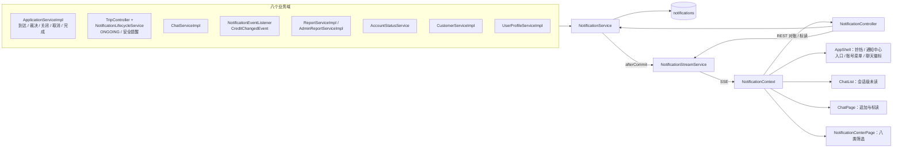

# 设计：add-realtime-notifications

- **Change：** `add-realtime-notifications`（`notifications` ADDED，REQ-029 / 实时通知中心与未读计数）
- **基线：** `origin/main@357f5e2`（壳层主题切换移除后）｜ **日期：** 2026-11-17（首版）/ 2026-11-18（八类扩围）｜ **Owner：** Karena（AO）
- **输入：** Delta Spec（8 Requirement / 36 Scenario）、`proposal.md`（D1–D18）、`g1-decision.md`（L-01 / L-02 / L-03 / D12 / 测量点）

## 1. 设计目标与分工铁律

把八类业务域里「需要用户知道或行动」的时刻，变成一条可核对的通知链：**服务端是唯一权威**（行、计数、文案、跳转目标），推送只是低延迟提示，客户端每次建立连接都用 REST 对账。任何一处失败都不能把业务动作本身变成失败。

**分工铁律：**

1. 通知行与未读计数只由后端产生与派生；前端不得自行累加出「真实未读数」，推送只做增量展示，REST 快照负责收敛。
2. 行程 / 申请 / 聊天 / 信用 / 举报 / 账号 / 客服 / 资料的规则一行不改（提案 Out of scope）；通知只在既有成功路径之后追加。
3. 推送通道失败不弹阻塞错误、不隐藏最后一次已知计数；业务成功不因通知失败而回滚（D6）。
4. 通知标题与正文只在后端 `NotificationTextUtils` 生成一次，前端直接展示 `title` / `content`；前端只负责类型标签、空态、时间格式与不可用提示。
5. 新增一个页面（`#/notifications`）；其它跳转复用既有路由（`#/trips/{id}`、`#/trips/{id}/applications`、`#/chat/{tripId}/{userId}`、`#/credit/records`、`#/reports/{id}`、`#/users/{id}`、`#/support`、`#/profile/setup`）。
6. 跳转规则只由后端 `target.kind` 决定，前端不按 `event` 自行猜路由（D15）。

## 2. 组件与职责



| 单元 | 落点 | 职责 |
|---|---|---|
| `NotificationController` | `backend/.../controller` | 列表、流、单条标读、范围标读；只做身份与参数校验、DTO 转换 |
| `NotificationService` / `NotificationServiceImpl` | `backend/.../service`、`service/impl` | 拥有 `notifications` 表；写入、去重、列表、计数、目标解析、可用性判定、标读范围、`afterCommit` 推送 |
| `NotificationLifecycleService` | `backend/.../service/impl` | 在读取行程详情时惰性物化 `trip_ongoing` 与 `safety_reminder`（无显式写入动作的状态） |
| `NotificationEventListener` | `backend/.../service/impl` | 监听既有 `CreditChangedEvent`，不改账本与业务分支 |
| `NotificationStreamService` / `NotificationStreamServiceImpl` | `backend/.../service`、`service/impl` | 按用户的 `SseEmitter` 注册表、20 s 心跳、发布与清理；**不写库** |
| `NotificationMapper` / `NotificationEntity` | `mapper`、`entity` | 单表 CRUD；无自定义 SQL |
| `Notification` / 5 个枚举 | `pojo`、`enums` | 领域 record 与 wire 值（类型、事件、优先级、状态、目标种类） |
| `NotificationTextUtils` | `utils` | `业务事实 → 中文标题 / 正文`，纯函数、无业务依赖；22 个事件各一段 |
| `NotificationNotFoundException` | `exception` | 404 `NOTIFICATION_NOT_FOUND` |
| `NotificationResponse` / `NotificationListResponse` / `NotificationCountsResponse` / `NotificationTargetResponse` / `NotificationEventResponse` | `response` | 契约出参；`actor` 复用 `DemoUserResponse` |
| `NotificationReadRequest` / `MyReportResponse` | `request`、`response` | 标读范围；举报人自查（承接举报类跳转） |
| `notificationModel.ts` | `frontend/src/notifications/` | 纯函数：快照合并、事件合并、标读归约、会话分组、直达地址、可用性、提示条件、徽标文本 |
| `NotificationContext.tsx` | 同上 | Context、`EventSource` 生命周期、REST 对账、提示条、活动会话 |
| `NotificationBell.tsx` / `NotificationPanel.tsx` | 同上 | 顶栏数字入口与面板（最新 50 条、全部已读、查看全部通知） |
| `NotificationCenterPage.tsx` | 同上 | `#/notifications`：八类筛选（带数字）、全部已读、类型标签、重要标记、不可用提示 |
| `NotificationBadge.tsx` | 同上 | 数字徽标（0 不渲染），供铃铛 / 侧栏 / 账号菜单 / tab / 会话行复用 |
| `notificationMessages.ts` | `frontend/src/i18n/` | 类型标签、空态、全部已读、不可用、加载失败等固定文案 |
| `App.tsx` / `AppShell.tsx` / `route.ts` | 既有 | 挂载提供者；铃铛；侧栏通知中心入口、账号菜单入口、聊天徽标；`#/notifications` 路由 |
| `ChatPage.tsx` / `ChatList.tsx` | 既有 | 打开会话标读、活动会话登记、推送追加、分会话徽标 |
| `CreditRecordsPage.tsx` / `ReportDetailPage.tsx` | 新增 | 承接 `credit` 与 `report` 两类跳转 |
| `chatTime.ts`（迁移） | `frontend/src/chat/` → `frontend/src/utils/` | `formatChatTime` 改为叶子模块，见 R-10；`notifications` 只依赖 `utils`，不依赖 `chat` |
| `types.ts` / `api.ts` / `styles.css` | 既有 | 类型、请求函数、徽标 / 面板 / 通知中心样式 |

## 3. 数据模型与迁移（D4 / D13 / D12）

`backend/src/main/resources/db/migration/V31__add_notifications.sql`：

```sql
CREATE TABLE notifications (
    id INTEGER NOT NULL PRIMARY KEY,
    recipient_id INTEGER NOT NULL,
    type VARCHAR(16) NOT NULL,
    event VARCHAR(40) NOT NULL,
    title VARCHAR(80) NOT NULL,
    content VARCHAR(512) NOT NULL,
    priority VARCHAR(8) NOT NULL,
    actor_id INTEGER,
    trip_id INTEGER,
    application_id INTEGER,
    message_id INTEGER,
    report_id INTEGER,
    session_id INTEGER,
    dedupe_key VARCHAR(120) NOT NULL,
    created_at VARCHAR(40) NOT NULL,
    read_at VARCHAR(40)
);

CREATE UNIQUE INDEX ux_notifications_recipient_dedupe ON notifications (recipient_id, dedupe_key);
CREATE INDEX ix_notifications_recipient_read ON notifications (recipient_id, read_at);
```

| 字段 | 语义 | 约束 |
|---|---|---|
| `id` | 通知 id | 主键；沿用 `nextId()`（MAX + 1），与既有表一致 |
| `recipient_id` | 收件人 | 必填；只按此列授权与计数 |
| `type` | 八个大写类型之一 | 必填；`NotificationTypeEnum.wireValue()` |
| `event` | 具体业务事件（snake_case） | 必填；`NotificationEventEnum.wireValue()` |
| `title` / `content` | 后端生成的标题与正文 | 必填；只由 `NotificationTextUtils` 产生 |
| `priority` | `NORMAL` / `HIGH` | 必填；低信用与恢复通知为 `HIGH` |
| `actor_id` | 动作人 | 可空；系统 / 信用 / 举报 / 账号 / 客服 / 认证类为 null |
| `trip_id` | 关联行程 | 可空；行程 / 申请 / 聊天 / 安全提醒使用 |
| `application_id` / `message_id` / `report_id` / `session_id` | 关联业务对象 | 可空；按事件类型各自填写 |
| `dedupe_key` | 同一业务事件的去重标识 | 必填；与 `recipient_id` 组成唯一索引 |
| `created_at` | 创建时刻（`Instant.toString()`） | 必填；列表倒序 |
| `read_at` | 已读时刻 | 空 = 未读；标读只写一次（`IS NULL` 条件） |

- **未读 = `read_at IS NULL`**，不建独立计数表（D4）。`status` 由它派生，永远无法与已读时间矛盾。
- **保留策略：** 行不删除；列表只返回最新 50 条（D13）。索引 `(recipient_id, read_at)` 覆盖计数与列表过滤。
- **去重键形态：** `application_received:{applicationId}`、`application_accepted:{applicationId}`、`application_rejected:{applicationId}`、`application_closed:{applicationId}`、`trip_full:{tripId}`、`trip_ongoing:{tripId}`、`trip_cancelled:{tripId}`、`trip_completed:{tripId}`、`message:{messageId}`、`credit:{ledgerId}`、`report_submitted:{reportId}`、`report_processing:{reportId}`、`report_resolved:{reportId}`、`account:{status}:{occurredAt}`、`service_joined:{sessionId}`、`service_reply:{messageId}`、`service_closed:{sessionId}`、`system_safety:{tripId}`、`system_identity:{userId}`。
- **时间格式：** 与既有实体一致，存 ISO-8601 字符串，字典序即时间序；列表按 `created_at DESC, id DESC`。
- **迁移号排他确认（D12）：** 合并 `main` 后 `openapi.yaml:4` 为 `0.24.0`，`db/migration/` 最大为 `V29__credit_exit_application.sql`；在 `openspec/changes/**`、`docs/**` 中检索 `V30__` / `0.26.0`，除本 change 自己的草稿外无其他 change 占用。故本 change 取 **`V31__add_notifications.sql` / 0.26.0**。
- **双引擎：** 只用 `INTEGER / VARCHAR / CREATE INDEX`，不用 SQLite 专属语法；`NotificationMigrationSqliteTest` 在 SQLite 上跑同一脚本，Spring 测试在 H2 上跑同一脚本。

## 4. 接口契约（`openapi.yaml` 0.24.0 → 0.26.0）

### 4.1 路径

| 方法 | 路径 | 身份 | 语义 |
|---|---|---|---|
| GET | `/notifications` | `X-User-Id` | 最新 50 条 + `counts{total, by_type}` |
| GET | `/notifications/stream` | `?user_id=` | 按用户的 SSE 通道（事件名 `notification`） |
| POST | `/notifications/{notificationId}/read` | `X-User-Id` | 单条标读，返回最新计数 |
| POST | `/notifications/read` | `X-User-Id` | `scope=all` / `scope=conversation` |
| GET | `/reports/mine` | `X-User-Id` | 举报人自查列表（承接 `report` 跳转所需的编号与状态） |

### 4.2 Schema

| Schema | 关键字段 |
|---|---|
| `NotificationType` | `TRIP` / `APPLICATION` / `CHAT` / `CREDIT` / `REPORT` / `ACCOUNT` / `SERVICE` / `SYSTEM` |
| `NotificationEventName` | 22 个 snake_case 事件值（契约枚举即唯一事实来源） |
| `NotificationPriority` | `NORMAL` / `HIGH` |
| `NotificationStatus` | `UNREAD` / `READ`（由 `read_at` 派生） |
| `NotificationTargetKind` | `trip` / `applications` / `chat` / `credit` / `report` / `account` / `support` / `identity` |
| `NotificationTarget` | `kind` 必填 + `trip_id` / `other_user_id` / `application_id` / `report_id` / `session_id` 可空 |
| `Notification` | `id`、`type`、`event`、`title`、`content`、`priority`、`status`、`created_at`、`read_at`、`actor`（可空）、关联 id、`target`、`related_available` |
| `NotificationCounts` | `total`、`by_type`（八个键恒出现，零值不省略） |
| `NotificationList` | `items`（最多 50）、`counts` |
| `NotificationReadRequest` | `scope` = `all` / `conversation`；后者需 `trip_id` + `other_user_id` |
| `NotificationEvent` | `notification` + 可空 `message`（聊天消息即时追加用） |

### 4.3 错误码

| 场景 | 状态码 | code |
|---|---|---|
| 缺少 / 未知用户 | 401 | `DEMO_USER_REQUIRED` |
| 单条标读的目标不存在或不属于本人 | 404 | `NOTIFICATION_NOT_FOUND` |
| `scope` 非法或缺会话定位 | 400 | `INVALID_INPUT` |

### 4.4 SSE 线格式

```
event: notification
data: {"notification":{...},"message":null}

: ping
```

- 不发送 `id:` 字段：重连正确性由客户端 REST 对账保证（D3），不做断点续传。
- 响应头固定 `Cache-Control: no-cache` 与 `X-Accel-Buffering: no`。
- 心跳为 SSE 注释行 `: ping`，约 20 秒一次。

### 4.5 契约测试同步点

`OpenApiTest` 断言 `info.version` 与关键 schema；`NotificationControllerTest` 断言 4 条通知路径的行为与响应头。两者同批更新，契约先于实现（C1）。

## 5. 后端行为

### 5.1 生产方钩子（D6 / D7）

| 事件 | 触发点 | 收件人 | 关联 |
|---|---|---|---|
| `application_received` | `ApplicationServiceImpl.apply` 成功后 | 行程发布者 | 行程 + 申请 |
| `application_accepted` / `application_rejected` | `decide` 成功后按裁决结果 | 申请者 | 行程 + 申请 |
| `trip_full` | `decide` 接受后行程人数达到容量 | 除动作人外的已接受参与者 | 行程 |
| `application_closed` | `onTripCancelled` 关闭待处理申请 | 该申请者 | 行程 + 申请 |
| `trip_cancelled` | `onTripCancelled` | 已接受同行者 | 行程 + 取消原因 |
| `trip_completed` | `onTripCompleted` | 已接受同行者 | 行程 |
| `trip_ongoing` / `safety_reminder` | `NotificationLifecycleService`（读取详情时） | 发布者 + 已接受同行者 | 行程 |
| `message` | `ChatServiceImpl.send` 落库后 | 接收方 | 行程 + 发送方 + 消息 |
| `credit_changed` / `credit_recovered` | `NotificationEventListener`（`CreditChangedEvent`） | 分数变动用户 | 无（正文含分数与原因） |
| `report_submitted` / `report_processing` / `report_resolved` | `ReportServiceImpl.submit`、`AdminReportServiceImpl` 的状态变更 | 举报人 | 举报 id |
| `account_suspended` / `account_banned` / `account_restored` | `AccountStatusService` 状态写入后 | 账号本人 | 无（正文含受限内容与恢复时间） |
| `service_joined` / `service_reply` / `service_closed` | `CustomerServiceImpl` 的三个动作 | 会话用户 | 客服会话 id |
| `identity_verified` | `UserProfileServiceImpl` 检测资料首次完整 | 本人 | 无 |

- 钩子一律放在既有成功路径**末尾**，不改任何判定与异常。
- 「动作人即收件人」的写入被 `write()` 直接丢弃（D7），因此发布者不会因自己的接受动作收到 `trip_full`；容量 2 时该通知只到同行者。
- `AccountStatusService` 通过 `ObjectProvider<NotificationService>` 取依赖，避免「账号 → 通知 → 账号」的构造期循环；`NotificationServiceImpl` 通过 mapper 做可用性检查，不反向依赖业务服务。

### 5.2 写入（`NotificationServiceImpl.write`）

1. `actorId == recipientId` → 直接返回（自事件抑制）。
2. 先查 `(recipient_id, dedupe_key)`，命中即返回（重复事件不刷屏）。
3. 组装 record：标题 / 正文来自 `NotificationTextUtils`；`created_at = clock.instant()`；`read_at = null`。
4. 插入；唯一索引冲突抛 `DuplicateKeyException` → 视为已去重，debug 记录。
5. 其它 `RuntimeException` → `log.warn` 后吞掉（D6）。
6. 推送前注册 `afterCommit`：有事务时事务提交后才 `publish`，保证客户端看到事件时行已落库；无事务时立即推送。

### 5.3 生命周期物化（`NotificationLifecycleService`）

`ONGOING` 与安全提醒没有显式写入动作（状态由时间推导）。`TripController.detail` 在返回详情前调用该服务：

- 若状态为 `ONGOING` 且当前用户是发布者或已接受同行者，则对每位参与者调用 `notifyTripOngoing` 与 `notifySystemSafetyReminder`。
- 去重键 `trip_ongoing:{tripId}` / `system_safety:{tripId}` 保证重复打开详情只生成一次。
- 该路径同样吞掉通知异常，详情响应不变。

### 5.4 列表与计数

- 列表：按 `recipient_id` 过滤，`created_at DESC, id DESC`，`MAX_LIST_SIZE = 50`；每条经 `describe()` 补 `actor`、`trip_title`、`target`、`related_available`。
- 计数：对八个 `NotificationTypeEnum` 各做一次未读 count，按枚举顺序写入 `LinkedHashMap`，零值不省略；`total` 为各类型之和。
- `related_available`：`REPORT` 校验举报存在且举报人是本人；`SERVICE` 校验会话存在且属于本人；`CREDIT` / `ACCOUNT` 恒真；其余（行程 / 申请 / 聊天 / 安全提醒）校验行程仍存在。
- `target`：按类型映射；`APPLICATION` 中只有 `application_received` 用 `applications`，其余用 `trip`；`SYSTEM` 中 `identity_verified` 用 `identity`，其余用 `trip`。

### 5.5 标读范围（D9）

| 操作 | 条件 | 结果 |
|---|---|---|
| 单条 | 本人且未读 | 写 `read_at`；已读或他人 → 已读不动 / 404 |
| 全部 | 本人全部未读 | 一次批量置为已读 |
| 单会话 | `type=CHAT` 且 `trip_id` 与 `actor_id` 同时匹配 | 只清该会话；其它会话与其它类型不变 |

- 所有标读都用 `read_at IS NULL` 作为更新条件，天然幂等。
- 标读只写通知表，不触碰任何业务表。

### 5.6 流注册表（`NotificationStreamServiceImpl`）

- `ConcurrentHashMap<Long, Set<SseEmitter>>`：同一用户可有多条连接（多标签页），全部收到。
- `connect` 注册 `onCompletion` / `onTimeout` / `onError` 清理。
- `publish` 对每个 emitter 加锁发送；单条失败只移除该连接，不影响其它用户与其它连接。
- 心跳由单线程守护调度器每 20 秒发送 `: ping`；`@PreDestroy` 停止并 complete 所有连接。
- 不存历史、不做断点续传：REST 是真相（D3）。

### 5.7 「3 秒内」的测量点

测量口径固定为：**生产方 HTTP 响应返回（通知行已提交）→ 浏览器端 `notification-badge` 文本变化**。E2E 在请求前记录 `Date.now()`，再用 `toHaveText('1', { timeout: 3000 })` 断言；不给服务端加人为延迟，也不以「SSE 帧到达」这种客户端不可见的事件为准。

## 6. 前端行为

### 6.1 状态与纯函数（`notificationModel.ts`）

| 函数 | 语义 |
|---|---|
| `emptyCounts` | 八类全 0 的计数对象；每次新建，避免共享可变状态 |
| `typeCount` | 某一类型未读数；未知类型按 0 |
| `isUnread` | `status === 'UNREAD'` |
| `applySnapshot` | 服务端快照与本地条目按 id 合并；超 50 截断；计数逐项取较大值；本地已读不被旧快照改回未读；早于 `lastReadSeq` 的快照只合并条目、不采用计数 |
| `applyCounts` | 采用服务端计数并推进 `lastReadSeq` |
| `applyEvent` | 新 id 入队首；同 id 不重复；活动会话的消息直接标读且不计入 `CHAT` |
| `markOneLocal` / `markAllLocal` / `markConversationLocal` | 本地标读归约，各自只影响约定范围；重复调用不变 |
| `unreadByConversation` | 按 `(trip_id, actor_id)` 分组统计 `CHAT` 未读 |
| `notificationHref` | 按 `target.kind` 组装路由；`account` 需 `viewerId`，缺省回资料页 |
| `notificationAvailable` | `related_available !== false` |
| `shouldToast` | 非 `CHAT` 恒真；`CHAT` 在对应会话打开时为假 |
| `badgeLabel` | 0 → 空串；其余原始数字（不截断为 99+） |

### 6.2 提供者与 `EventSource` 生命周期（D3）

- 启动：当前用户存在时先 `GET /notifications`，再 `new EventSource('/api/notifications/stream?user_id=…')`。
- `onopen` 与每次浏览器的自动重连都会重新拉一次 REST 快照，使漏推与重连收敛。
- `onmessage`：解析 `NotificationEvent`；聊天消息若属于活动会话则转发给聊天页；否则并入状态并按 `shouldToast` 决定是否提示。
- 切换用户 / 登出：关闭连接并清空状态。
- 失败：`onerror` 不弹阻塞错误，保留最后一次已知计数；浏览器自动重连，`onopen` 再对账。

### 6.3 徽标（D8）

| 位置 | 数字 | 探针 |
|---|---|---|
| 顶栏铃铛 | `counts.total` | `notification-badge` |
| 侧栏「通知中心」入口 | `counts.total` | `rail-notification-badge` |
| 账号菜单入口 | `counts.total` | `account-notification-badge` |
| 侧栏聊天入口 | `counts.by_type.CHAT` | `rail-chat-badge` |
| ≤900 px 移动 tab 聊天入口 | `counts.by_type.CHAT` | `tab-chat-badge` |
| 会话列表行 | 该会话的 `CHAT` 未读 | `chat-unread-badge` |

- 0 时不渲染；数字以文本呈现，可读语义放在外层 `aria-label`。

### 6.4 面板与通知中心

- 面板：最新通知、类型标签、时间、未读标记；「全部已读」与「查看全部通知」；打开时新事件只更新列表，不抢焦点；Escape 关闭并把焦点还给铃铛。
- 通知中心 `#/notifications`：八类筛选（`notification-filter-<TYPE>`，各带数字）+「全部」；`notification-center-item` 逐条展示类型、时间、重要标记、未读 / 已读文字与正文；`notification-center-mark-all` 一键全部已读；空态区分「全部」与「某类型」。
- 激活一条：先 `markOneLocal` 并调用单条标读；`notificationAvailable` 为假时提示「相关内容当前不可查看」且不跳转；否则按 `notificationHref` 跳转。

### 6.5 聊天整合（D10）

- `ChatPage` 打开会话时登记活动会话并调用 `scope=conversation` 标读；该会话的新消息经推送直接追加，未读数保持 0。
- 3 秒轮询保留为兜底；推送与轮询不会产生重复消息（按消息 id 合并）。
- `ChatList` 用 `unreadByConversation` 渲染每行徽标。

### 6.6 可访问性与响应式

- 铃铛可键盘触达；面板为可关闭的浮层，Escape 关闭并归还焦点。
- 窄屏 ≤900 px：底部 tab 保留聊天徽标，铃铛仍可点开，通知中心单列且无横向滚动。
- 徽标数字是唯一计数信息，颜色与圆点只做辅助。

### 6.7 E2E 探针

`notification-bell`、`notification-badge`、`notification-panel`、`notification-item`、`notification-mark-all`、`notification-center`、`notification-center-item`、`notification-center-mark-all`、`notification-filter-ALL`、`notification-filter-<TYPE>`、`notification-center-empty`、`rail-notification-badge`、`account-notification-badge`、`rail-chat-badge`、`tab-chat-badge`、`chat-unread-badge`、`report-detail`、`report-detail-status`。

## 7. 端点 → Requirement → 场景

| 端点 / 触发 | Requirement | 场景 |
|---|---|---|
| `GET /notifications` | 未读计数与标读规则；通知中心与跳转 | S30-2、S30-25、S30-26、S30-32 |
| `POST /notifications/{id}/read` | 未读计数与标读规则 | S30-27、S30-29、S30-30、S30-32 |
| `POST /notifications/read` `all` | 未读计数与标读规则 | S30-28 |
| `POST /notifications/read` `conversation` | 未读计数与标读规则 | S30-31 |
| `GET /notifications/stream` | 实时投递与失败隔离 | S30-33 ～ S30-36 |
| 申请 / 裁决钩子 | 申请与裁决事件 | S30-9 ～ S30-12 |
| 行程钩子 + `TripController.detail` | 行程生命周期事件；客服与系统事件 | S30-5 ～ S30-8、S30-19 |
| `ChatServiceImpl.send` | 聊天、信用、举报与账号事件 | S30-13 |
| `CreditChangedEvent` | 聊天、信用、举报与账号事件 | S30-14、S30-15 |
| 举报三阶段 | 聊天、信用、举报与账号事件 | S30-16 |
| `AccountStatusService` | 聊天、信用、举报与账号事件 | S30-17 |
| 客服三阶段 | 客服与系统事件 | S30-18 |
| `UserProfileServiceImpl` | 客服与系统事件 | S30-20 |
| `target` + `related_available` | 通知中心与跳转 | S30-21 ～ S30-24 |
| `write()` 去重 / 自事件抑制 / 只增不删 | 通知记录、类型与生命周期 | S30-1、S30-3、S30-4 |

## 8. G1 遗留项与规格评审意见的收口

| 遗留 | 落点 |
|---|---|
| L-01 / S-01 提示条（D14） | §6.2 `shouldToast` + `tasks.md` T11 + E2E M8 |
| L-02 / S-02 失败隔离跨生产方 | §5.2 步骤 5 + `NotificationFailureIsolationTest`（申请、裁决、发消息、客服） |
| L-03 / S-03 契约回指 Requirement | §7 端点 → Requirement → 场景 |
| D12 契约 / 迁移排他 | §3 排他确认：0.26.0 / `V31__add_notifications.sql` |
| 测量点 | §5.7 |

## 9. 测试策略

| 层 | 落点 | 覆盖 |
|---|---|---|
| U（纯函数） | `NotificationTextUtilsTest`（7）、`NotificationTypeEnumTest`（4）、`NotificationEntityTest`（2）、`notificationModel.test.ts` | 22 段文案、枚举 wire 值、实体往返、快照 / 事件 / 标读 / 分组 / 直达 / 徽标 |
| S（服务） | `NotificationServiceTest`（10） | 八类写入、去重、自事件抑制、计数、三种标读、50 条上限、越权 404 |
| 钩子 | `NotificationProducerTest`（6）、`NotificationHookTest`（3） | 生产方与事件 / 收件人的对应关系；容量 2 时满员通知只到同行者 |
| 失败隔离 | `NotificationFailureIsolationTest`（3） | 通知抛错时业务动作仍成功 |
| 流 | `NotificationStreamServiceTest`（3） | 只推收件人、多连接、单连接失败清理、心跳 |
| API | `NotificationControllerTest`（9）、`ReportControllerTest` | 4 条路径、SSE 头、404 / 400 / 401、`/reports/mine` |
| 迁移 | `NotificationMigrationSqliteTest`（1） | SQLite 建表 / 唯一索引 / 插入 / 标读 |
| 契约 | `OpenApiTest` | 0.26.0、路径、schema 必需字段 |
| E2E | `notifications.spec.ts`（13）、`notifications-walkthrough.spec.ts`（4） | M1–M10 + N1–N3；V1–V4 |

## 10. 风险、例外与边界

| id | 风险 | 处理 |
|---|---|---|
| R-1 | 代理缓冲导致 3 秒口径不达标 | 控制器写禁缓冲响应头 + 20 s 心跳；E2E 经 Vite 代理实测 |
| R-2 | 内存 emitter 在重启 / 多实例下失效 | REST 对账把「丢事件」降级为「延迟」；单进程 demo 可接受 |
| R-3 | 查询参数身份可伪造 | 与既有 `X-User-Id` 同级暴露；真实鉴权 change 收口 |
| R-4 | 六处计数（铃铛 / 侧栏 / 账号菜单 / tab / 会话行）漂移 | 同一 store 派生 + reducer 纯函数单测 |
| R-5 | 行无限增长 | D13 明确不清理；长期另开需求 |
| R-6 | 50 条展示上限导致会话级徽标少计 | 接受为展示边界；通知入口以服务端计数为准 |
| R-7 | 命名冲突：既有 `NotificationService` 语义 | 流服务命名为 `NotificationStreamService`，写入服务保留 `NotificationService` |
| R-8 | 通知噪声 | 去重键 + 自事件抑制 + 只发相关方 + 当前会话不提示 |
| R-9 | 在途快照把已读计数改回未读 | `lastReadSeq` 护栏 + `status` 单调（已读不回退） |
| R-10 | `chatTime` 迁移破坏既有引用 | 移到 `utils/` 后原断言不改，作为「迁移无行为变化」的守护 |
| R-11 | 账号服务与通知服务循环依赖 | `ObjectProvider` 延迟取依赖 + mapper 判定可用性 |
| R-12 | ONGOING 通知永不生成或重复生成 | 读取详情时惰性物化 + 去重键 |
| R-13 | SSE 断开时 `AsyncRequestNotUsableException` 日志 | 已知噪声：客户端关闭标签页的正常现象，不影响功能（D-4） |
| R-14 | 管理员备注 / 他人隐私进入通知 | 文案只使用结构化事实；封禁只展示原因码标签与恢复时间 |
| — | Blocker | 无 |