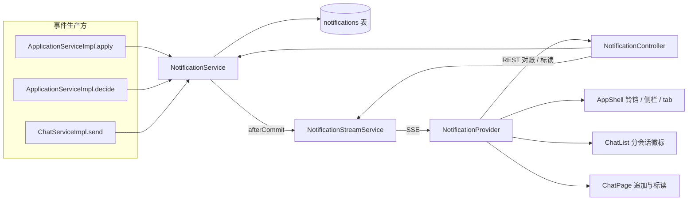

# 设计：add-realtime-notifications

- **Change：** `add-realtime-notifications`（`notifications` ADDED，REQ-023 / 实时通知与未读计数）
- **基线：** `origin/feature/add-realtime-notifications@c64b33f` ｜ **日期：** 2026-11-17 ｜ **Owner：** Karena（AO）
- **输入：** Delta Spec（6 Requirement / 26 Scenario）、`proposal.md`（D1–D14）、`g1-decision.md`（L-01 / L-02 / L-03 / D12 / 测量点）

## 1. 设计目标与分工铁律

把「有人申请 / 申请被裁决 / 收到消息」变成一条可核对的通知链：**服务端是唯一权威**（行、计数、文案），推送只是低延迟提示，客户端每次建立连接都用 REST 对账。任何一处失败都不能把申请、裁决或发消息变成失败。

**分工铁律：**

1. 通知行与未读计数只由后端产生与派生；前端不得自行累加出「真实未读数」，推送只做增量展示，REST 快照负责收敛。
2. 申请状态机、聊天准入、行程状态、容量与裁决权限一行不改（提案 Out of scope）。
3. 推送通道失败不弹阻塞错误、不隐藏最后一次已知计数；业务成功不因通知失败而回滚（D6）。
4. 通知文案只在后端 `NotificationTextUtils` 生成一次，前端直接展示 `text`；前端只负责面板标题、空态与时间格式。
5. 不新增页面、不新增前端路由；通知面板是顶栏入口的浮层，直达复用既有 `#/trips/{id}` 与 `#/chat/{tripId}/{userId}`。

## 2. 组件与职责



| 单元 | 落点 | 职责 |
|---|---|---|
| `NotificationController` | `backend/.../controller` | 列表、流、单条标读、范围标读；只做身份与参数校验、DTO 转换 |
| `NotificationService` / `NotificationServiceImpl` | `backend/.../service`、`service/impl` | 拥有 `notifications` 表；写入、列表、计数、标读范围、`afterCommit` 推送 |
| `NotificationStreamService` / `NotificationStreamServiceImpl` | `backend/.../service`、`service/impl` | 按用户的 `SseEmitter` 注册表、心跳、发布与清理；**不写库**（命名见 §10 R-7） |
| `NotificationMapper` / `NotificationEntity` | `mapper`、`entity` | 单表 CRUD；无自定义 SQL |
| `Notification` / `NotificationTypeEnum` | `pojo`、`enums` | 领域 record 与四类事件的 wire 值 |
| `NotificationTextUtils` | `utils` | `(type, actorNickname, tripTitle) → 中文文案`，纯函数、无业务依赖 |
| `NotificationNotFoundException` | `exception` | 404 `NOTIFICATION_NOT_FOUND` |
| `NotificationResponse` / `NotificationListResponse` / `NotificationCountsResponse` / `NotificationEventResponse` | `response` | 契约出参；`actor` 复用 `DemoUserResponse` |
| `NotificationReadRequest` | `request` | `scope` + 会话定位 |
| `notificationModel.ts` | `frontend/src/notifications/` | 纯函数：快照合并、事件合并、标读归约、分会话分组、直达地址、提示条件、徽标文本 |
| `NotificationProvider.tsx` | `frontend/src/notifications/` | Context、`EventSource` 生命周期、REST 对账、提示条、活动会话 |
| `NotificationBell.tsx` / `NotificationPanel.tsx` | `frontend/src/notifications/` | 顶栏数字入口与面板（最新 50 条、全部已读） |
| `NotificationBadge.tsx` | `frontend/src/notifications/` | 数字徽标（0 不渲染），供铃铛 / 侧栏 / tab / 会话行复用 |
| `notificationMessages.ts` | `frontend/src/i18n/` | 面板标题、空态、全部已读、加载失败等固定文案 |
| `App.tsx` / `AppShell.tsx` | 既有 | 挂载提供者；顶栏铃铛；侧栏与移动 tab 的消息徽标 |
| `ChatPage.tsx` / `ChatList.tsx` | 既有 | 打开会话标读、活动会话登记、推送追加、分会话徽标 |
| `chatTime.ts`（迁移） | `frontend/src/chat/` → `frontend/src/utils/` | `formatChatTime` 改为叶子模块，见 §10 R-10；`notifications` 只依赖 `utils`，不依赖 `chat` |
| `types.ts` / `api.ts` / `styles.css` | 既有 | 类型、请求函数、徽标 / 面板 / 提示样式（明暗两套） |

## 3. 数据模型与迁移（D4 / D13 / D12）

`backend/src/main/resources/db/migration/V30__add_notifications.sql`：

```sql
-- REQ-023 real-time notifications: one durable row per delivered event.
-- Portable across SQLite (runtime and migration tests) and H2 (Spring tests).

CREATE TABLE notifications (
    id INTEGER NOT NULL PRIMARY KEY,
    recipient_id INTEGER NOT NULL,
    type VARCHAR(24) NOT NULL,
    actor_id INTEGER NOT NULL,
    trip_id INTEGER NOT NULL,
    application_id INTEGER,
    message_id INTEGER,
    created_at VARCHAR(40) NOT NULL,
    read_at VARCHAR(40)
);

CREATE INDEX ix_notifications_recipient_read ON notifications (recipient_id, read_at);
```

| 字段 | 语义 | 约束 |
|---|---|---|
| `id` | 通知 id | 主键；沿用 `nextId()`（MAX + 1），与既有表一致 |
| `recipient_id` | 收件人 | 必填；只按此列授权与计数 |
| `type` | `application_received` / `application_accepted` / `application_rejected` / `message` | 必填；枚举 wire 值 |
| `actor_id` | 动作人（申请者 / 裁决者 / 消息发送方） | 必填；列表展示昵称与头像首字 |
| `trip_id` | 关联行程 | 必填；直达与分会话定位 |
| `application_id` | 申请类关联的申请 | 申请类必填，消息类为空 |
| `message_id` | 消息类关联的消息 | 消息类必填，申请类为空 |
| `created_at` | 创建时刻（`Instant.toString()`） | 必填；列表倒序 |
| `read_at` | 已读时刻 | 空 = 未读；标读只写一次（`IS NULL` 条件） |

- **未读 = `read_at IS NULL`**，不建独立计数表（D4）。类型拆分由 `type` 派生。
- **保留策略：** 行不删除；列表只返回最新 50 条（D13）。索引 `(recipient_id, read_at)` 覆盖计数与列表过滤。
- **时间格式：** 与既有实体一致，存 ISO-8601 字符串，字典序即时间序；列表按 `created_at DESC, id DESC`。
- **迁移号排他确认（D12）：** `openapi.yaml:4` 为 `0.17.0`；`db/migration/` 最大为 `V23__add_travel_mode.sql`；在 `openspec/changes/**`、`docs/**` 中检索 `V30__` / `0.18.0`，除本 change 自己的草稿外无其他 change 占用（含 `add-ai-itinerary`）。故本 change 取 **`V30` / 0.18.0**。
- **双引擎：** 只用 `INTEGER / VARCHAR / CREATE INDEX`，不用 SQLite 专属语法；`NotificationMigrationTest` 在 SQLite 上跑同一脚本，Spring 测试在 H2 上跑同一脚本。

## 4. 接口契约（`openapi.yaml` 0.17.0 → 0.18.0）

### 4.1 路径

| 方法 | 路径 | 身份 | 语义 |
|---|---|---|---|
| `GET` | `/notifications` | `X-User-Id` | 最新 50 条 + 三项未读计数 |
| `GET` | `/notifications/stream` | 查询参数 `user_id` | 该用户的 SSE 通道 |
| `POST` | `/notifications/{notificationId}/read` | `X-User-Id` | 单条标读，返回最新计数 |
| `POST` | `/notifications/read` | `X-User-Id` | 全部 / 单会话标读，返回最新计数 |

- 所有普通端点缺 `X-User-Id` → 沿用 `DEMO_USER_REQUIRED`（401）；流端点缺 `user_id` 或用户不存在 → 同样 401。
- 单条标读不属于本人或不存在 → 404 `NOTIFICATION_NOT_FOUND`（不暴露他人通知存在性）。
- `scope=conversation` 缺 `trip_id` / `other_user_id`，或 `scope` 非法 → 400 `INVALID_INPUT`。
- 两个标读端点成功时返回 `NotificationCounts`（最新三项计数），客户端用它覆盖本地计数；`scope=all` 忽略定位字段。

### 4.2 Schema

```yaml
NotificationType:
  type: string
  enum: [application_received, application_accepted, application_rejected, message]

Notification:
  required: [id, type, actor, trip_id, trip_title, text, created_at, read]
  properties:
    id: { type: integer, format: int64, readOnly: true }
    type: { $ref: '#/components/schemas/NotificationType' }
    actor: { $ref: '#/components/schemas/DemoUser' }
    trip_id: { type: integer, format: int64, readOnly: true }
    trip_title: { type: string, readOnly: true }
    application_id: { type: integer, format: int64, nullable: true, readOnly: true }
    message_id: { type: integer, format: int64, nullable: true, readOnly: true }
    text: { type: string, readOnly: true }
    created_at: { type: string, format: date-time, readOnly: true }
    read: { type: boolean, readOnly: true }

NotificationCounts:
  required: [total, application, message]
  properties:
    total: { type: integer, minimum: 0, readOnly: true }
    application: { type: integer, minimum: 0, readOnly: true }
    message: { type: integer, minimum: 0, readOnly: true }

NotificationList:
  required: [items, counts]
  properties:
    items: { type: array, maxItems: 50, items: { $ref: '#/components/schemas/Notification' } }
    counts: { $ref: '#/components/schemas/NotificationCounts' }

NotificationReadRequest:
  required: [scope]
  properties:
    scope: { type: string, enum: [all, conversation] }
    trip_id: { type: integer, format: int64, nullable: true }
    other_user_id: { type: integer, format: int64, nullable: true }

NotificationEvent:
  required: [notification]
  properties:
    notification: { $ref: '#/components/schemas/Notification' }
    message: { $ref: '#/components/schemas/ChatMessage', nullable: true }
```

- `text` 由后端生成（示例）：
  - `application_received` → `「小周」申请加入「周末去珠海骑行」`
  - `application_accepted` → `「阿岚」接受了你的申请（「周末去珠海骑行」）`
  - `application_rejected` → `「阿岚」拒绝了你的申请（「周末去珠海骑行」）`
  - `message` → `「小周」发来一条消息（「周末去珠海骑行」）`
- `message` 只在 `type=message` 的推送载荷中出现，内容为刚保存的 `ChatMessage`；REST 列表不含消息正文。

### 4.3 错误码

| 错误码 | HTTP | 触发 |
|---|---|---|
| `NOTIFICATION_NOT_FOUND` | 404 | 单条标读的 id 不存在或不属于当前用户 |
| `INVALID_INPUT` | 400 | `scope` 非法、`scope=conversation` 缺定位、请求体缺失 |
| `DEMO_USER_REQUIRED` | 401 | 缺 `X-User-Id` / `user_id`，或用户不存在 |

- `scope=all` 时忽略 `trip_id` / `other_user_id`（不报错）；`scope=conversation` 时两者必填，缺一即 400。

### 4.4 SSE 线格式

```text
HTTP/1.1 200 OK
Content-Type: text/event-stream;charset=UTF-8
Cache-Control: no-cache
X-Accel-Buffering: no

event: notification
data: {"notification":{"id":7,"type":"message",...},"message":{"id":31,...}}

: ping
```

- 事件名固定 `notification`；`data` 是单行 JSON（`NotificationEvent`）。
- 心跳为 SSE 注释行 `: ping`，约每 20 秒一次；不改 `spring.mvc.async.request-timeout`，`SseEmitter` 以 `0L` 表示不超时，由心跳与断开回调清理。
- **不发送 `id:` 字段**：客户端不使用 `Last-Event-ID`，重连正确性由 §6.2 的 REST 对账保证，避免暗示服务端可重放。
- 开发经 Vite `/api` 代理直接流式转发；生产若加 nginx，需要 `proxy_buffering off`（`X-Accel-Buffering: no` 已在响应头声明）。

### 4.5 契约测试同步点

- `OpenApiTest` 中两处 `assertEquals("0.17.0", ...)` 同步改为 `0.18.0`。
- 新增 `in_openApiFile_out_notificationContractDeclared`：4 条路径、`NotificationType` 枚举、`NotificationCounts` 最小值为 0、`NotificationList.items.maxItems=50`、`NotificationReadRequest.scope` 枚举、`NotificationEvent` 必需字段、`NOTIFICATION_NOT_FOUND` 错误码。

## 5. 后端行为

### 5.1 生产方钩子（D6 / D7，L-02）

| 生产方 | 触发点 | 收件人 | 动作人 | 关联 |
|---|---|---|---|---|
| `ApplicationServiceImpl.apply` | `save(application)` 之后、方法返回前 | `trip.publisherId()` | `applicantId` | `tripId` + `applicationId` |
| `ApplicationServiceImpl.decide` | `updateStatus(...)` 之后（接受与拒绝都走这里） | `application.applicantId()` | `publisherId` | `tripId` + `applicationId`，按 `next` 取 accepted / rejected |
| `ChatServiceImpl.send` | `save(message)` 之后 | `receiverId` | `senderId` | `tripId` + `messageId` + 消息正文 |

- **只在既有成功路径末尾调用**：所有状态机校验（重复申请、非 pending、未开放 / 已满、聊天准入、只读）都在调用之前完成；被拒绝的请求不会走到通知。
- **自消息守卫：** `receiverId == senderId` 时不创建行。当前 `ChatServiceImpl.requireAccess` 已拒绝自消息，此守卫是防御性的，保证规格 S23-5 在未来放宽准入时仍成立。
- **失败隔离（L-02，跨所有生产方）：** `NotificationServiceImpl.notify*` 整个方法体 `try/catch(RuntimeException)`，记 `log.warn` 后返回；生产方不写 try/catch，也不因通知抛错而回滚。该方法**不加 `@Transactional`**：
  - 它加入调用方已有事务（MyBatis 映射使用同一连接），行与业务同生共死；
  - 异常在同一个事务边界内被捕获，不经过事务代理，因此不会把共享事务标记为 rollback-only；
  - 若数据库错误已使连接不可用，整个请求本来就会失败，属既有故障域，不在 D6 的「通知失败」范围内。
- **推送时机：** 行写入后，用 `TransactionSynchronizationManager.isSynchronizationActive()` 判断：
  - 有事务 → `registerSynchronization(afterCommit → streamService.publish(...))`。业务回滚则行消失、`afterCommit` 不执行，**不会出现「业务没成但通知已推」**；
  - 无事务（例如单测直接调用）→ 立即发布。
- **发布不阻塞提交：** `publish` 只做内存投递并自行吞掉单个 emitter 的异常；`afterCommit` 运行在请求线程，不引入队列或线程池。

### 5.2 写入（`NotificationServiceImpl`）

1. `recipientId == actorId` → 直接返回（不写行）。
2. 解析 `DemoUser actor = demoUserService.require(actorId)`、`TripPlan trip = tripPlanService.require(tripId)`，生成 `text`。
3. `save(NotificationEntity.from(notification))`。
4. 注册 `afterCommit` 推送（见 §5.1）。
5. 任何一步异常 → `log.warn("notification skipped: type={}, recipient={}, trip={}", ...)`，吞掉异常。

`Notification` 领域 record：`id / recipientId / type / actorId / tripId / applicationId / messageId / createdAt / readAt`。

### 5.3 列表与计数

- 列表：`lambdaQuery().eq(recipient).orderByDesc(createdAt).orderByDesc(id)`，用 `page(new Page<>(1, 50, false), query)` 取前 50，再逐条组装 `NotificationResponse`（`actor` 取 `DemoUserResponse`，`trip_title` 取 `tripPlanService.require(tripId).title()`）。50 条以内的 N+1 与既有 `ChatService.partners` 同口径。
- 计数：三次 `count`（`recipient_id` + `read_at IS NULL`，再分别加 `type IN (...)` / `type = 'message'`），分别得到 `total` / `application` / `message`；全部走 `(recipient_id, read_at)` 索引，不缓存、不建计数表。
- 计数与列表在**同一响应**返回（`NotificationList`），避免前端看到两个时刻的快照。
- `NotificationResponse.read` 由 `read_at != null` 派生；`created_at` 直接透传 ISO-8601 字符串。

### 5.4 标读范围（D9）

| 入口 | 条件 | 结果 |
|---|---|---|
| 单条 | `WHERE id = ? AND recipient_id = ?` | 不存在或非本人 → 404；已读 → 不变；未读 → 写 `read_at`，总数恰好减 1 |
| 全部 | `WHERE recipient_id = ? AND read_at IS NULL` | 全部写 `read_at`，总数归 0 |
| 单会话 | `WHERE recipient_id = ? AND read_at IS NULL AND type = 'message' AND trip_id = ? AND actor_id = ?` | 只清该会话的消息；申请类与其它会话不变 |

- 全部用 `lambdaUpdate().set(readAt, now).isNull(readAt)`，重复调用不改变计数（幂等）。
- 单会话的「对方 id」= 通知的 `actor_id`（消息发送方），与前端 `(tripId, otherUserId)` 会话键一一对应。
- 每次标读后重新计算三项计数并返回，客户端用返回值覆盖本地计数。

### 5.5 流注册表（`NotificationStreamService`）

- 状态：`ConcurrentHashMap<Long, Set<SseEmitter>>`，每个用户可同时有多个标签页连接；集合用 `ConcurrentHashMap.newKeySet()`。
- `connect(userId, emitter)`：注册；在 `onCompletion` / `onTimeout` / `onError` 中移除并 `complete()`；同一 emitter 的发送在实例上 `synchronized`，避免心跳与业务推送交叉写。
- `publish(userId, event)`：遍历该用户全部 emitter；单个发送失败 → 移除该 emitter，继续下一个；整体不向上抛。
- 心跳：`ScheduledExecutorService`（daemon，单线程，`@PostConstruct` 启动、`@PreDestroy` 关闭），每 20 秒向所有 emitter 发送 `SseEmitter.event().comment("ping")`；失败即清理。
- 线程数：不占请求线程（servlet async），无额外依赖。

### 5.6 流端点

```java
@GetMapping("/notifications/stream")
public ResponseEntity<SseEmitter> stream(@RequestParam(name = "user_id", required = false) Long userId) {
    DemoUser reader = demoUserService.require(userId);
    SseEmitter emitter = new SseEmitter(0L);
    streamService.connect(reader.id(), emitter);
    return ResponseEntity.ok()
            .header(HttpHeaders.CACHE_CONTROL, "no-cache")
            .header("X-Accel-Buffering", "no")
            .contentType(MediaType.TEXT_EVENT_STREAM)
            .body(emitter);
}
```

- 身份只用于订阅；通知内容仍按 `recipient_id` 过滤，别人的通道拿不到该事件。
- 连接建立后不主动补发历史；客户端在 `onopen` 调 `GET /notifications` 对账（D3）。

### 5.7 「3 秒内」的测量点

- **T0** = 生产方 HTTP 响应完整返回客户端（此时事务已提交，通知行已存在）；
- **T1** = 收件人前端的顶栏徽标文本变为新计数（React 完成一次渲染）。
- 口径：`T1 − T0 ≤ 3000 ms`，只度量推送路径；重连后的 REST 对账不计入该窗口。
- 验证方式：Playwright 双上下文，记录 `Date.now()`，用 `expect(badge).toHaveText(..., { timeout: 3000 })` 断言；失败时保留 trace。

## 6. 前端行为

### 6.1 状态与纯函数（`notificationModel.ts`）

```ts
type NotificationState = { items: AppNotification[]; counts: NotificationCounts };
```

| 函数 | 输入 → 输出 | 规则 |
|---|---|---|
| `emptyCounts()` | → `{total:0, application:0, message:0}` | — |
| `applySnapshot(state, list, seq)` | REST 响应 + 发起序号 → 新状态 | 按 id 合并，保留双方较新的 50 条；`read` **单调**（本地已读不会被旧快照改回未读）；计数取**逐项较大值**，但若本次快照的发起序号早于最近一次已应用的标读响应（`lastReadSeq > seq`），则只合并条目、**不采用其计数**，避免在途快照把刚标读掉的计数复活（§10 R-9） |
| `applyEvent(state, event, activeKey)` | 推送 + 活动会话 → 新状态 | 同 id 已存在则原样返回（不重复）；插入队首并截断 50；消息类且属于活动会话 → 该条以 `read: true` 插入且不加计数；否则按类型加 1 |
| `markOneLocal(state, id)` | 已读 id | 已读则不变；未读则置 `read: true` 并对应减 1 |
| `markConversationLocal(state, tripId, otherId)` | 会话 | 只把 `type=message && trip_id && actor.id=otherId` 且未读的置读；按条数减 `message`/`total` |
| `markAllLocal(state)` | — | 全部置读，计数归零 |
| `unreadByConversation(items)` | → `Map<conversationKey, number>` | 键 `"${tripId}:${otherId}"`；只统计未读 `message` |
| `notificationHref(item)` | → `string` | 申请类 → `#/trips/{trip_id}`；消息类 → `#/chat/{trip_id}/{actor.id}` |
| `shouldToast(item, activeKey)` | → `boolean` | 申请类恒 `true`；消息类仅在**没有活动会话或键不同**时 `true`（D14） |
| `badgeLabel(count)` | → `string` | `count > 0 ? String(count) : ''`；不截断成 `99+`，保证显示的是数字 |

- 计数永远从同一份 `items` 派生或用服务端返回值覆盖；四处徽标读同一个 Context（D8）。
- **序号护栏：** Provider 维护单调递增的 `seq`，每次发起 `GET /notifications` 记下发起时的 `seq`，每个标读响应应用时把 `lastReadSeq` 置为当时的 `seq`；`applySnapshot` 用这两个值判断是否可采用计数。纯函数只接收数值，不读时钟，便于单测。
- 分会话徽标从 `items` 派生，受 50 条展示上限约束（§10 R-6）。

### 6.2 提供者与 `EventSource` 生命周期（D3）

`App.tsx` 在 `ProfileProvider` 内、`AppShell` 外包一层 `<NotificationProvider currentUser={currentUser}>`。

```text
mount / user 变化
  → GET /notifications（快照）
  → new EventSource(`/api/notifications/stream?user_id=${id}`)
       onopen    → 再 GET /notifications（对账，避免断线期间漏推）
       notification → applyEvent + 可能提示
       onerror   → 不弹窗、不清空计数；由 EventSource 自动重连，下一次 onopen 再对账
unmount / 登出 → source.close()，清空状态
```

- 对账是**合并**不是替换：REST 永远追加真相，推送不丢；同 id 去重。
- `connected` 只用于内部（避免重复建立连接），不做额外状态 UI。
- 活动会话：Context 暴露 `activeConversation` 与 `setActiveConversation`；`ChatPage` 在选中会话时登记，离开时清空。提示条件与「当前会话不累计未读」都以它为唯一输入。

### 6.3 提示条（D14 / L-01）

- 触发：收到 `notification` 事件且 `shouldToast(item, activeConversation)` 为真。
- 形态：`antd message.info({ content: item.text, key: `notification-${item.id}`, duration: 4 })`；同一 id 只显示一次（`key` 天然去重），不抢焦点、不阻塞。
- 申请类恒提示；消息类仅在对应会话未打开时提示；当前会话直接追加、不提示。
- 可断言口径：E2E 断言 `.ant-message-notice-content` 出现且包含 `text`；在当前会话收到消息后，提示条数量**不增加**。

### 6.4 徽标（D8）

| 位置 | 数值来源 | 落点 | 0 时 |
|---|---|---|---|
| 顶栏铃铛 | `counts.total` | `.topbar` 的 `NotificationBell` | 不渲染徽标；`aria-label` 仍为「通知」 |
| 侧栏聊天入口 | `counts.message` | `AppShell` 的 `rail-link` 内数字徽标 | 不渲染 |
| 移动 tab 聊天入口 | `counts.message` | `AppShell` 的 `tab-link` 内数字徽标（≤900 px 生效） | 不渲染 |
| 会话行 | `unreadByConversation(items)` | `ChatList` 每行的数字徽标 | 不渲染 |

- 徽标文本就是数字；颜色只是强调，不是唯一信息（`NotificationBadge` 内含 `aria-hidden` 的数字文本，外层入口的 `aria-label` 同步报数）。
- 不新增断点：≤900 px 沿用既有 `tabbar` 显隐；侧栏与 tab 读同一个 `counts.message`。
- 样式只新增 `.notification-*` / `.count-badge` 类，使用 `--danger` / `--surface` / `--line` / `--on-deep`，明暗主题各验一次；不改既有布局结构。

### 6.5 面板与直达

- `NotificationBell` 用 antd `Popover`（`trigger="click"`、`placement="bottomRight"`）承载 `NotificationPanel`；面板 `role="dialog"`、`aria-label="通知"`。
  - **G2 后修订（D-7）：** 实测 `Popover` 的入场动画在 rAF 被节流的标签页里会停在 `ant-zoom-big-appear-prepare`（`opacity: 0`），点击铃铛看不到面板。实现改为 `createPortal` + `position: fixed`，按铃铛的视口矩形定位（与 `.rail-menu` 账号菜单同构），不依赖入场动画；同时给条目补上类型标签（同行申请 / 申请通过 / 申请未通过 / 聊天消息），让四类事件不只靠正文措辞区分。详见 `docs/sdd/add-realtime-notifications/p4-implementation.md` §5 D-7。
- 面板内容：标题 + 「全部已读」（`counts.total === 0` 时禁用）+ 条目列表（动作人昵称、`text`、`formatChatTime(created_at)`（来自 `frontend/src/utils/chatTime.ts`，见 §10 R-10）、未读文字标记「未读」）。
- 无通知 → 空态文案；加载失败 → 一行可读提示 + 重试，不弹阻塞对话框。
- 条目点击：先 `markOneRead(id)`（乐观 + 服务端计数覆盖）→ `window.location.hash = notificationHref(item)` → 关闭面板。
- 面板打开时新事件只重渲染列表，不移动焦点；Escape 关闭并把焦点还给铃铛，不抢当前页面焦点。

### 6.6 聊天整合（D10 / S23-24）

- `ChatPage` 选中会话后：
  1. `setActiveConversation({tripId, otherId})`；
  2. `markConversationRead(tripId, otherId)`，用返回计数覆盖本地；
  3. 若本地该会话未读数仍 > 0（例如重连快照晚到），再次标读，直到收敛。
- 推送到达且属于活动会话：从 `event.message` 追加（按 id 去重），调用 `markConversationRead`；该会话计数保持 0，申请类计数不受影响。
- 3 秒轮询保留：每次成功加载消息后，若本地该会话未读数 > 0，调用一次 `markConversationRead`，覆盖「推送漏掉但轮询看到」的路径。
- 离开会话：`setActiveConversation(null)`。

### 6.7 可访问性与响应式

- 铃铛是 `button`，`aria-haspopup="dialog"`、`aria-expanded`；徽标数字进入 `aria-label`（如「通知，3 条未读」）。
- 会话行徽标同时有 `aria-label`（如「3 条未读消息」）。
- 窄屏 390 px：面板宽 `min(360px, calc(100vw - 24px))`，不出现横向滚动；顶栏铃铛始终可触达。
- 明暗主题：徽标、面板、未读标记、空态都不写死颜色。

### 6.8 E2E 探针

`data-testid`：`notification-bell`、`notification-badge`、`notification-panel`、`notification-item`、`notification-mark-all`、`chat-unread-badge`、`rail-chat-badge`、`tab-chat-badge`、`notification-toast`。

## 7. 端点 → Requirement → 场景（L-03 / S-03）

| 端点 / 生产方 | Requirement | Scenario |
|---|---|---|
| `POST /trips/{tripId}/applications`（既有，新增钩子） | 申请与裁决产生持久化通知 | S23-1、S23-4、S23-10、S23-26 |
| `POST /applications/{id}/accept` / `reject`（既有，新增钩子） | 申请与裁决产生持久化通知 | S23-2、S23-3、S23-26 |
| `POST /trips/{tripId}/messages`（既有，新增钩子） | 聊天消息产生通知 | S23-5、S23-6、S23-10、S23-24、S23-26 |
| `GET /notifications` | 未读计数与通知列表 | S23-7、S23-8、S23-9、S23-10 |
| `GET /notifications/stream` | 实时投递 | S23-11、S23-12、S23-13、S23-14、S23-15 |
| `POST /notifications/{id}/read` | 标读范围 | S23-16、S23-19、S23-20 |
| `POST /notifications/read`（`all` / `conversation`） | 标读范围 | S23-17、S23-18、S23-19、S23-20 |
| 前端 `NotificationProvider` + `AppShell` + `ChatList` + `ChatPage` | 壳层指示与直达 | S23-21、S23-22、S23-23、S23-24、S23-25 |

- 没有无主端点：4 条新路径与 3 个生产方钩子全部回指 Requirement；契约任务在 `tasks.md` 中同样标注上述 Requirement。

## 8. G1 遗留项与规格评审意见的收口

| 来源 | 问题 | 本设计的处理 |
|---|---|---|
| L-01 / S-01 | 「短提示」没有 Delta 场景 | §6.3 定义触发条件、形态与可断言口径；`tasks.md` 落实现与一条 E2E；不在 Delta 中新增场景（提示是展示细节，不改变可观察的通知语义） |
| L-02 / S-02 | 失败隔离只写在申请类 | §5.1 把 `try/catch` 下沉到 `NotificationServiceImpl.notify*`，对申请、裁决、消息三条路径同时生效；`tasks.md` 为消息路径补反向断言 |
| L-03 / S-03 | 契约增量缺少规格锚点 | §7 的端点 → Requirement → Scenario 对照；契约与测试任务逐条引用 |
| D12 | `0.18.0` / `V30` 排他性 | §3 记录检索结果；`tasks.md` T1 定稿前再复核一次 |
| G1 测量点 | 「3 秒内」如何量 | §5.7 固定 T0 / T1 与 Playwright 断言方式 |
| D6 顺序 | 通知与业务事务的顺序 | §5.1 同事务写入 + `afterCommit` 推送；回滚不推 |

## 9. 测试策略

| 层 | 用例 |
|---|---|
| 后端纯函数（U） | `NotificationTextUtilsTest`：四类文案、昵称 / 标题含中文、未知类型回退；`NotificationTypeEnumTest`：wire 值稳定 |
| 后端服务（S） | `NotificationServiceTest`（`@SpringBootTest` / `@Transactional`，相对计数）：申请 → 发布者 1 条；接受 / 拒绝 → 申请者 1 条；自消息 → 0 条；被拒绝的申请 → 0 条；读一条恰好减一；读全部归零；读会话只清该会话；重复标读不变；按用户隔离 |
| 后端失败隔离（S） | `NotificationFailureIsolationTest`：`@TestConfiguration` + `@Primary` 的 `NotificationService` 桩（查询委托真实 bean，`notify*` 抛异常），断言 `accept` 仍返回 accepted、`send` 仍返回消息；另用匿名子类覆盖 `save` 抛错，断言 `notify*` 本身不抛 |
| 后端流服务（S） | `NotificationStreamServiceTest`：注册后可查到连接数；向 A 发布不影响 B；心跳不抛；`complete` / 失败发送后连接被移除；用户可多连接 |
| 后端接口（B） | `NotificationControllerTest`（MockMvc）：列表字段与 50 条上限、计数三元组、单条标读 200 / 404 / 幂等、`scope=all` / `conversation` / 非法 scope 400、缺身份 401；流端点只断言 `asyncStarted` 与响应头，内容由流服务与 E2E 覆盖 |
| 后端契约（B） | `OpenApiTest`：0.18.0、4 条路径、schema 必需字段、`NOTIFICATION_NOT_FOUND`、`maxItems=50` |
| 后端迁移（B） | `NotificationMigrationTest`：SQLite 执行 `V30` 后表与索引存在；插入 / 查询 / 标读可用；H2 由 Spring 测试上下文覆盖 |
| 前端纯函数（F） | `notificationModel.test.ts`：快照合并去重 / 截断、事件同 id 去重、活动会话不加计数、三处标读归约、分会话分组、直达地址、提示条件、徽标 0 隐藏；`utils/chatTime.test.ts`（由 `chat/chatTime.test.ts` 迁移）：4 条既有断言原样通过，证明迁移不改口径 |
| E2E（M） | `notifications.spec.ts`：申请到达（铃铛 +1、面板出现、≤3 s）；接受 / 拒绝；消息到地图页（rail / tab +1、提示条）；打开会话归零；读一条 / 全部已读；两个会话只清一个；刷新后计数不变；当前会话推送直接出现且不提示；390 px 数字一致 |
| 人工走查（V） | 1440 / 768 / 390 × 浅 / 深色；后端重启后客户端重连对账；停掉后端时计数保留且无阻塞弹窗 |

- **Red / Green 顺序**见 `atdd-design.md`；每个切片先出一条失败测试，再写最小实现。
- 后端测试使用既有 H2 内存库与种子数据；通知断言用「操作前 / 后计数差」而不是绝对 id，避免依赖种子行号。

## 10. 风险、例外与边界

| # | 事项 | 处理 |
|---|---|---|
| R-1 | SSE 被代理缓冲导致 3 秒不达标 | `X-Accel-Buffering: no` + `Cache-Control: no-cache` + 20 s 心跳；P4 经 Vite 代理实测，E2E 断言 3 s |
| R-2 | 后端重启丢失内存 emitter | 单进程 demo 可接受；`onopen` REST 对账把「丢事件」降级为「延迟」 |
| R-3 | `user_id` 查询参数可伪造 | 与既有 `X-User-Id` 同级信任；真实鉴权另开 change |
| R-4 | 四处计数漂移 | 同一 store + 纯函数归约 + 单测；服务端计数在标读响应中覆盖 |
| R-5 | 行无限增长 | D13 明确不清理；长期另开需求 |
| R-6 | 分会话徽标受 50 条上限约束 | 总徽标以服务端计数为准；分会话徽标按可见的未读消息条目派生。单会话未读 > 50 且最旧条目被挤出时可能少计，属 D13 展示上限的已知边界；全量分会话计数另开需求 |
| R-7 | 提案中的 `NotificationBroker` 与包命名规则 | 实现落为 `NotificationStreamService`（接口）+ `NotificationStreamServiceImpl`（`@Service`，无表、不继承 `IService`），以符合 `service` / `service/impl` 与 `XxxService` 后缀规则；提案里的 `NotificationBroker` 只作为职责描述，不改变任何已签语义。 |
| R-8 | 通知写入在同一事务内失败 | `notify*` 内部捕获，不标记 rollback-only；若连接本身失效，整个请求失败，属既有故障域 |
| R-9 | 50 条快照、推送与标读的竞争 | 快照按 id 合并、`read` 单调、计数取逐项较大值；标读响应是唯一允许计数下降的来源。在途快照若发起早于最近一次标读响应，则只合并条目、不采用其计数（`seq` 护栏，§6.1），避免计数被复活。 |
| R-10 | `notifications` 复用 `formatChatTime` 会形成包环（`chat` 反向依赖通知上下文）| 违反 `@rule:no-circular-dependency`。把 `formatChatTime` 从 `frontend/src/chat/chatTime.ts` 迁到叶子 `frontend/src/utils/chatTime.ts`（无 import）；`notifications` 只依赖 `utils`。同步改 4 处既有 import（`ChatList`、`ChatMain`、`chatMeeting`、`admin/service/ServiceConversation`）与测试文件位置，逻辑与文案不变。 |

**不做（边界）：**

- 不改申请 / 聊天 / 行程 / 容量 / 权限规则；不新增通知历史页、筛选、分组、偏好、清理任务。
- 不做邮件、短信、OS 推送、Service Worker、WebSocket、消息队列。
- 不在前端复制未读计数规则或通知文案；不把消息正文写进通知表。
- 不替换 3 秒聊天轮询（D10）。