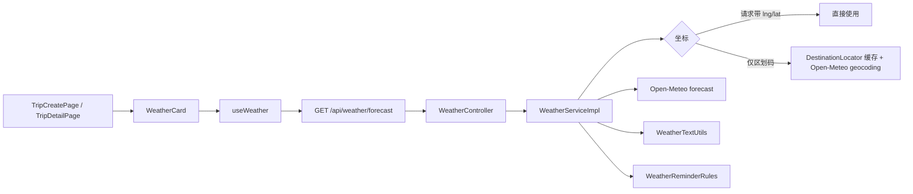

# 设计：add-trip-weather

- **Change：** `add-trip-weather`（`trip-weather` ADDED，REQ-022）
- **基线：** `origin/main@225eb0e` ｜ **日期：** 2026-11-17 ｜ **Owner：** Jay（AO）
- **输入：** `specs/trip-weather/spec.md`（6 / 28）、`proposal.md`、`g1-decision.md`（C1–C6）

## 1. 设计目标

把「目的地 + 日期」变成一张可复用的天气卡：后端是唯一的取数与提醒权威（真实数据、固定阈值、失败不编造），前端只负责状态机与渲染。两处页面共用同一组件与同一接口，避免两套口径。

**分工铁律：** 天气数值只来自 Open-Meteo；坐标只来自请求或 Open-Meteo geocoding；提醒只由后端按固定阈值推导；前端不得自行判断阈值，也不得在失败态编造占位数值。

## 2. 组件与职责



| 单元 | 落点 | 职责 |
|---|---|---|
| `WeatherCard` | `frontend/src/weather/WeatherCard.tsx` | 五态渲染（未就绪 / 加载 / 秒出 / 越界 / 失败），重试按钮 |
| `useWeather` | `frontend/src/weather/useWeather.ts` | 请求、防竞态（递增 token）、重试、依赖变化重取 |
| `weather.ts` | `frontend/src/weather/weather.ts` | 纯函数：请求键、日期标签、温度区间文案、提醒 tone 映射 |
| `messages.ts` | `frontend/src/weather/messages.ts` | 全部中文文案（含阈值外的固定标签） |
| `WeatherController` | `backend/.../controller` | 查询参数校验与响应 |
| `WeatherService` / `Impl` | `backend/.../service`、`service/impl` | 窗口判定、坐标解析、上游调用、归一、缓存 |
| `WeatherQuery` | `backend/.../param` | 目的地码、日期、可选坐标 |
| `DestinationLocator` | `backend/.../service/impl` | 区划码 → 坐标（geocoding + 进程内缓存） |
| `WeatherReminderRules` | `backend/.../pojo` | 阈值常量与提醒生成（纯函数） |
| `WeatherTextUtils` | `backend/.../utils` | WMO 4677 → 中文文案（纯函数） |
| `WeatherProperties` / `WeatherConfig` | `backend/.../config` | 两个上游地址与带超时的 `RestClient` |
| `WeatherForecast` / `WeatherDaily` / `WeatherReminder` | `backend/.../pojo` | 响应模型 |
| `WeatherUpstreamException` | `backend/.../exception` | 上游失败 → 502 `WEATHER_UPSTREAM_ERROR` |

## 3. 接口契约（D1）

`GET /api/weather/forecast?destination_code=440100&date=2026-11-21[&lng=113.26&lat=23.13]`

| 参数 | 必填 | 说明 |
|---|---|---|
| `destination_code` | 条件必填 | 6 位区划码；与 `lng`/`lat` 至少提供一组 |
| `date` | 是 | `yyyy-MM-dd`；窗口今天 ~ 今天 + 15（`Asia/Shanghai`） |
| `lng` / `lat` | 否 | 已有高德选点坐标时优先使用；必须成对出现 |

**响应（可用）**

```json
{
  "date": "2026-11-21",
  "destination_code": "440100",
  "city": "广州市",
  "lng": 113.2644,
  "lat": 23.1291,
  "available": true,
  "reason": null,
  "weather": {
    "weather_code": 61,
    "weather_text": "小雨",
    "temp_max_c": 24.0,
    "temp_min_c": 17.0,
    "precipitation_probability_pct": 80,
    "precipitation_mm": 5.2,
    "wind_speed_kmh": 18.0,
    "uv_index": 3.0
  },
  "reminders": [
    { "code": "rain", "text": "降雨概率 80%，记得带伞，户外行程注意防雨" }
  ],
  "source": "open-meteo"
}
```

**响应（越界）**：`available: false`、`reason: "OUT_OF_RANGE"`、`weather: null`、`reminders: []`、`lng/lat: null`（不为此解析坐标），HTTP 200。

**错误**：非法参数 → 400 `INVALID_INPUT`；上游失败 / 无当日数据 → 502 `WEATHER_UPSTREAM_ERROR`。错误响应体沿用 `ErrorResponse`，前端只用错误码决定文案。

**契约号段：** 0.13.0 → **0.16.0**（0.14.0 / 0.15.0 已被在途 change 预约；C3 在 P4 定稿前复核）。

## 4. 后端行为

### 4.1 参数校验

1. `lng`/`lat` 只提供一个 → 400 `INVALID_INPUT`。
2. 无坐标且 `destination_code` 不是受支持区划码（`AreaNames.isValidCityCode`）→ 400 `INVALID_INPUT`。
3. 坐标越界（`lng` ∉ [-180, 180] 或 `lat` ∉ [-90, 90]）→ 400 `INVALID_INPUT`。
4. `date` 早于今天或晚于今天 + 15 → 200 + `available:false` + `OUT_OF_RANGE`（**不请求上游，不解析坐标**）。

### 4.2 坐标解析（D2）

- 有请求坐标 → 直接用，`city` 取区划码的显示名（无区划码时返回 geocoding 解析出的名字或空串）。
- 无请求坐标 → `DestinationLocator`：
  - 缓存键 = 区划码；进程内 `ConcurrentHashMap`，无过期（城市坐标是静态事实）。
  - 请求 `GET {geocoding-base-url}/v1/search?name={城市名}&count=1&language=zh&countryCode=CN&format=json`。
  - 城市名先取 `AreaNames.cityDisplayNameOf(code)`；无结果时去掉结尾「市 / 地区 / 自治州 / 特别行政区 / 盟 / 新区」再试一次。
  - 仍无结果或上游失败 → `WeatherUpstreamException`（502）。**不缓存失败**，允许重试。
- 不使用途经点 / 集合点坐标。

### 4.3 上游调用与归一

`GET {base-url}/v1/forecast?latitude=&longitude=&daily=temperature_2m_max,temperature_2m_min,precipitation_probability_max,precipitation_sum,weather_code,wind_speed_10m_max,uv_index_max&timezone=Asia%2FShanghai&start_date={date}&end_date={date}`

- 解析 `daily`（Jackson 3，与 `AreaNames` 同源）；按 `daily.time` 找到请求日期；找不到 → 502。
- 字段：`weather_code`（int，缺省 0）、`temperature_2m_max` / `temperature_2m_min`（必填）、`precipitation_probability_max`（可空）、`precipitation_sum`（可空）、`wind_speed_10m_max`（可空）、`uv_index_max`（可空）。
- 温度必填缺失 → 502（没有温度不算可用天气）；其余缺省归一为 `null`，前端不展示对应行。
- `source` 恒为 `open-meteo`。

### 4.4 提醒规则（D6，C4）

常量全部集中在 `WeatherReminderRules`，阈值只此一处：

| code | 触发条件 | 文案要点 | 顺序 |
|---|---|---|---|
| `rain` | `precipitation_probability_pct ≥ 50` 或 `precipitation_mm ≥ 1` | 携带雨伞 / 雨具；`≥80%` 或 `≥10 mm` 时附加「注意户外行程安排」 | 1 |
| `heat` | `temp_max_c ≥ 30` | 防晒、及时补水 | 2 |
| `uv` | `uv_index ≥ 6` | 防晒霜、帽子等防晒措施 | 3 |
| `cold` | `temp_min_c ≤ 10` | 携带外套 | 4 |
| `temperature_gap` | `temp_max_c - temp_min_c ≥ 10` | 早晚温差，备外套 | 5 |
| `wind` | `wind_speed_kmh ≥ 30` | 防风，户外注意安全 | 6 |
| `calm` | 以上均未命中 | 天气平稳，按计划出行 | 7 |

- 返回顺序固定为表中顺序（L-02）。
- 文案内嵌真实数值（如「降雨概率 80%」「最高 33°C」），便于用户核对。
- UV 为 `null` 时不生成 `uv` 提醒（不把缺失当 0）。
- 天气不可用时 `reminders` 为空数组。

### 4.5 状态与时间

- 「今天」用注入的 `Clock` + `TripTimeZoneConstant.ZONE`（`Asia/Shanghai`）判定，窗口 `[today, today+15]`。
- 缓存与失败：坐标缓存只存成功结果；上游失败不入缓存。

## 5. 前端行为

### 5.1 状态机（L-01，C2）

```text
idle        缺目的地或日期 → 提示「选择目的地与日期后展示天气」，不展示任何数值
loading     请求进行中 → Skeleton + 文案；不展示上一次结果
ready       available=true → 天气行 + 提醒列表
unavailable available=false → 「暂无该日期天气预报」+ 说明（不改用当前天气）
error       请求失败 → 可读提示 + 重试按钮
```

- 状态由 `useWeather` 输出，`WeatherCard` 只渲染；不出现「loading 同时显示旧数据」。
- 重试 = 用同一参数重新请求（token 递增）。

### 5.2 请求与防竞态

- `useWeather({ destinationCode, date })`：
  - 依赖变化 → token +1 → 发请求；响应回来时 token 不是最新则丢弃。
  - 依赖不完整 → 直接 `idle`，且不发请求。
  - 失败 → `error`，保留参数供重试。
- 详情页使用行程的 `destination_code` 与 `start_date`；发布页使用 `destinationCode` 与 `startDate`。
- 不在页面卸载后 setState（`active` 标记）。

### 5.3 展示（D3，D4）

| 位置 | 挂载点 | 说明 |
|---|---|---|
| 路线创建页 | `publish-side`：预览卡之后、安全提示之前 | 卡片标题「目的地天气」+ 来源标签 + 日期标签 |
| 行程详情页 | 信息区（`.detail-section`）在日期之后 | 同样卡片；日期取行程开始日期 |

- 字段顺序：状态文案 + 温度区间 → 降雨概率 / 降水量 / 风速 / UV（有则显示）→ 提醒列表。
- 提醒前置小标签（雨 / 热 / 防晒 / 冷 / 温差 / 风 / 平稳），颜色用既有令牌。
- 日期标签：`weatherMessages.dateLabel(date)` → 「11 月 21 日（首日）」。
- 文案全部在 `weather/messages.ts`；不硬编码在组件里。

### 5.4 可访问性与响应式

- 天气区 `role="status"`（加载）与 `role="alert"`（失败）。
- 加载与失败态均有可读文本，不用纯图标表达。
- 390px：提醒纵向堆叠，字段自动换行；不出现横向滚动（沿用 `.publish-side` 既有宽度约束）。

### 5.5 E2E 探针

`data-testid`：`weather-card`、`weather-loading`、`weather-ready`、`weather-error`、`weather-retry`、`weather-out-of-range`、`weather-idle`、`weather-reminder`。

## 6. 契约（openapi.yaml 0.16.0）

- 新路径 `GET /weather/forecast`（servers 前缀 `/api`）。
- 新 schema：`WeatherForecast`、`WeatherDaily`、`WeatherReminder`。
- 响应：200（可用 / 越界共用）、400 `INVALID_INPUT`、502 `WEATHER_UPSTREAM_ERROR`。
- `OpenApiTest` 断言版本与必需字段（`available`、`source`、`weather.weather_code`、`reminders`）。

## 7. 测试策略

| 层 | 用例 |
|---|---|
| 纯函数（后端） | `WeatherTextUtilsTest`（已知码 / 未知码）、`WeatherReminderRulesTest`（每类阈值上下界、多类同命中顺序、UV null、全部未命中） |
| 接口（后端） | `WeatherControllerTest`：JDK `HttpServer` 替身（geocoding + forecast），覆盖可用 / 越界不请求上游 / 上游 500 / 无当日数据 / 坐标缺参 / 非法区划码 / 缓存命中只解析一次 |
| 契约（后端） | `OpenApiTest`：版本 0.16.0、路径与 schema 必需字段、502 错误码 |
| 纯函数（前端） | `weather.test.ts`：请求键、日期标签、温度区间、提醒 tone、`toCardState` 五态映射 |
| E2E | `weather.spec.ts`：发布页成功 / 修改目的地刷新 / 越界 / 失败重试 / 详情页展示（`page.route` 拦截后端天气接口） |
| 走查 | 1440 / 768 / 390 × 浅 / 深色 |

## 8. 与 `add-ai-itinerary` 的合并顺序（C1）

- 本 change 的路径、类名、契约字段为**权威**：`GET /api/weather/forecast`、`WeatherForecast`、`WeatherDaily`、`source`。
- `add-ai-itinerary` 合并时：删除其自身的 `WeatherController` / `WeatherService` / `WeatherServiceImpl` / `WeatherProperties` / `WeatherConfig` / `WeatherForecast` / `WeatherText`，改为注入本 change 的服务；其 AI 生成流程只需拿 `WeatherDaily` 拼提示词。
- 两边 `source` 字段一致（`open-meteo`），前端 AI 页的天气来源标签不受影响。
- 若 `add-ai-itinerary` 先合并：本 change 在 P4 前 rebase，冲突按「保留本 change 实现、AI 侧改为复用」处理，并在 PR 描述记录。

## 9. 不做（边界）

- 不新增数据库列 / 迁移；不缓存天气响应到库。
- 不做多日逐天、逐小时、历史天气、空气质量、预警推送。
- 不改目的地选择控件，不改发布 / 详情既有契约字段。
- 不把天气接进 AI 提示词（属 `add-ai-itinerary`）。
- 不在前端复制阈值判断。

## 10. 风险与对策

| 风险 | 对策 |
|---|---|
| 上游失败或超时 | 4s / 8s 超时；失败 502；前端可重试；不阻断业务 |
| 缓存永久驻留导致跨城错位 | 键为区划码，值与城市一一对应；城市坐标静态，不需要过期 |
| 城市名 geocoding 不命中 | 去后缀重试一次；仍失败则明确报错（不猜坐标） |
| 提醒文案与阈值漂移 | 阈值与文案都在后端一处；前端只渲染返回文本 |
| 契约号段冲突 | P4 定稿前复核；必要时顺延 |
| 与 AI change 重叠 | §8 合并顺序 + PR 描述核对 |